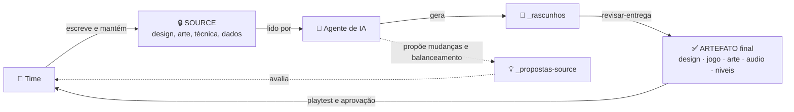
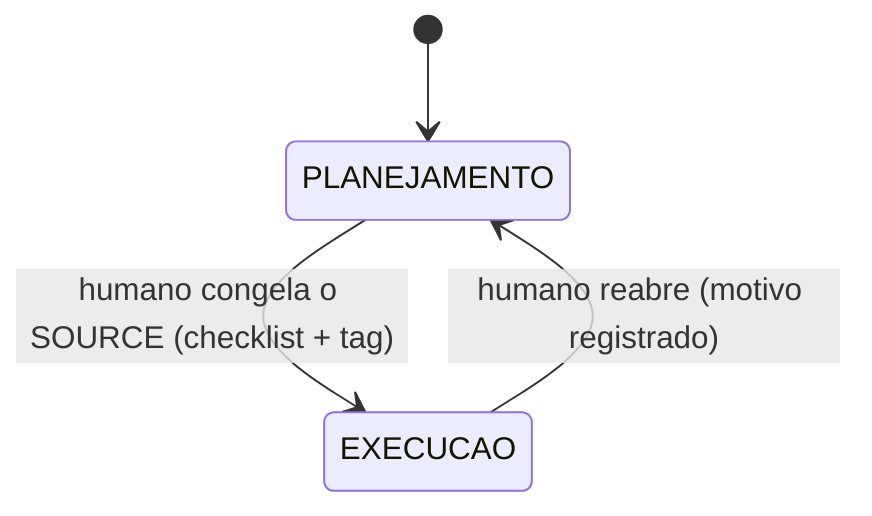
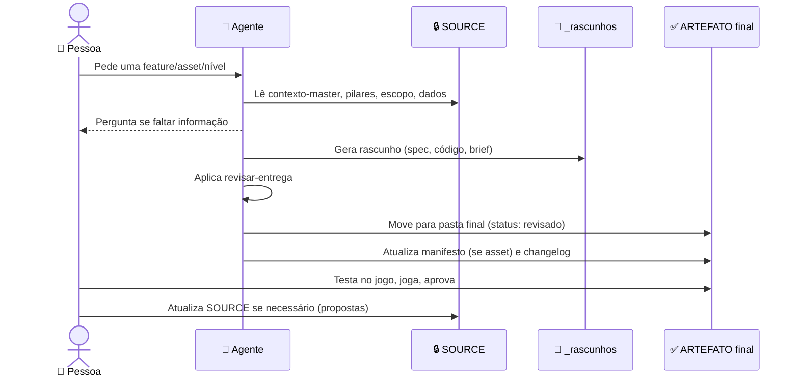
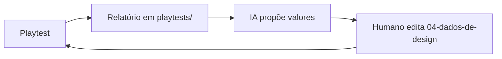

# 🧭 Guia da Arquitetura SOURCE / ARTEFATO para Games

> Manual da equipe para criar jogos com agentes de IA (**Claude, GPT, Cursor, Copilot**...) de forma organizada, rastreável e segura.

---

## 📑 Sumário
1. [Objetivo](#1--objetivo)
2. [A ideia em 1 minuto](#2--a-ideia-em-1-minuto)
3. [Modos de operação: PLANEJAMENTO e EXECUÇÃO](#3--modos-de-operação-planejamento-e-execução)
4. [Níveis de complexidade e Startup building](#4--níveis-de-complexidade-e-startup-building)
5. [O que muda em relação ao template genérico](#5--o-que-muda-em-relação-ao-template-genérico)
6. [Mapa completo](#6--mapa-completo)
7. [Princípios de ouro](#7--princípios-de-ouro)
8. [O ciclo de trabalho (modo EXECUÇÃO)](#8--o-ciclo-de-trabalho-modo-execução)
9. [Pasta por pasta](#9--pasta-por-pasta)
10. [Arquivo por arquivo](#10--arquivo-por-arquivo)
11. [Prompts de planejamento (um por arquivo)](#11--prompts-de-planejamento-um-por-arquivo)
12. [Papéis do time](#12--papéis-do-time)
13. [Fases do projeto](#13--fases-do-projeto)
14. [Módulos: manter ou apagar](#14--módulos-manter-ou-apagar)
15. [Perfis: Vibe/Jam e Produção](#15--perfis-vibejam-e-produção)
16. [Como começar um projeto novo](#16--como-começar-um-projeto-novo)
17. [Convenções](#17--convenções)
18. [Erros comuns](#18--erros-comuns)
19. [FAQ](#19--faq)

---

## 1. 🎯 Objetivo

Garantir que **toda pessoa e todo agente de IA** do time saibam:

| Pergunta | Onde está |
|---|---|
| Que jogo estamos fazendo e por quê? | `SOURCE/00-conceito` |
| Como o jogo funciona e quais são os números? | `SOURCE/01-design` + `04-dados-de-design` |
| Como deve parecer, soar e ser construído? | `SOURCE/02` e `03` |
| O que a IA pode ou não pode fazer? | `SOURCE/05-agentes` |
| O que já foi produzido e em que estado? | `ARTEFATO/` |

---

## 2. ⚡ A ideia em 1 minuto



---

## 3. 🔁 Modos de operação: PLANEJAMENTO e EXECUÇÃO

Todo projeto está **sempre em um de dois modos**, definido no arquivo `MODO.md` (raiz). **Só humanos** mudam o modo.



| | 📝 PLANEJAMENTO | ⚙️ EXECUÇÃO |
|---|---|---|
| **Objetivo** | Construir e editar o SOURCE | Produzir as entregas a partir do SOURCE |
| **IA edita SOURCE?** | ✅ Sim, por prompt direto, um arquivo por vez | ⛔ Não |
| **IA gera ARTEFATO final?** | ⛔ Não (só `_rascunhos/` e relatórios) | ✅ Sim |
| **Como a IA sugere mudanças** | Edita direto (com log) | Cria proposta em `ARTEFATO/_propostas-source/` |
| **Log** | `ARTEFATO/_logs/changelog-source.md` | `ARTEFATO/_logs/changelog-ia.md` |
| **Quem aprova** | Dono do projeto aprova o SOURCE | Humanos aprovam artefatos |

### Como funciona na prática
1. **Início:** `MODO.md` nasce em `PLANEJAMENTO`. Use a tabela de prompts (próxima seção) para a IA gerar a primeira versão de cada arquivo.
2. **Congelamento:** rode os prompts **PC** (consistência) e **PG** (gate), cumpra o checklist do `MODO.md`, faça commit + tag `source-v1.0` e mude `modo:` para `EXECUCAO`.
3. **Execução:** a IA lê o SOURCE e produz artefatos. Se achar erro, **propõe**; não edita.
4. **Reabertura:** quando houver propostas aceitas ou mudança de rumo, o humano volta para `PLANEJAMENTO`, edita, incrementa a versão e congela de novo.

### Segurança dos modos
- `AGENTS.md` manda a IA ler o `MODO.md` **antes de qualquer ação**.
- Modo ausente ou inválido = tratado como **EXECUÇÃO** (o mais restritivo).
- Nenhum modo permite que a IA edite `MODO.md`, `AGENTS.md` ou `CLAUDE.md`.
- Reforço opcional: `.claude/exemplos/` (permissões do Claude Code) e proteção da pasta `SOURCE/` na branch principal. Os dois são complementos; a regra é o `MODO.md`.
- As skills em `SOURCE/05-agentes/skills/` são usadas em **EXECUÇÃO**; em PLANEJAMENTO a IA trabalha com os prompts da tabela.

---

## 4. 🎚️ Níveis de complexidade e Startup building

O projeto nasce do template `ai-game-template` em **modo STARTUP**. O agente faz até 2 rodadas de perguntas, calcula a pontuação (5 perguntas, 0 a 10 pontos), mostra um **diagnóstico** para aprovação humana e só então cria a estrutura do nível a partir do pacote `niveis/<nivel>.zip`, pré-preenche o SOURCE, renomeia a pasta e entra em **PLANEJAMENTO**.

| | 🟢 SIMPLES | 🟡 MÉDIO | 🔴 COMPLEXO |
|---|---|---|---|
| Arquivos obrigatórios | 15 | 32 | 36 (+ opcionais) |
| Prompts de planejamento | 1 único | 1 por pasta | 1 por arquivo |
| Congelamento do SOURCE | opcional | por tag | gate completo (PC + PG) |
| Limite do contexto-master | 40 linhas | 80 linhas | 120 linhas |

- Pontuação, matriz de arquivos e promoção: **`NIVEIS.md`**.
- Prompts do seu nível (só com os arquivos que existem): **`PROMPTS-PLANEJAMENTO.md`**.
- Ferramenta do projeto (humanos rodam): `python tools/nivel.py verificar | promover | proteger`.
- O workflow `.github/workflows/verificar-nivel.yml` roda as verificações a cada push e PR. Nomes: `NOMENCLATURA.md`.

---

## 5. 🔀 O que muda em relação ao template genérico

| Tema | Por que jogos são diferentes | Como a arquitetura resolve |
|---|---|---|
| **Engine exige estrutura própria** | Godot/Unity/Unreal precisam de uma raiz de projeto específica | O projeto da engine vive em `ARTEFATO/jogo/` |
| **Balanceamento é dado, não código** | Números mudam o tempo todo após playtests | `SOURCE/04-dados-de-design/` (CSV/JSON) é a verdade; o código só lê |
| **Muitos assets binários** | PNG, áudio e modelos pesam e não têm "cabeçalho" | Git LFS (`.gitattributes`) + `manifesto-de-assets.csv` |
| **Direitos autorais e IA** | Arte/áudio gerados por IA ou de lojas exigem controle de licença | Manifesto com origem, prompt e licença; revisão antes do lançamento |
| **Diversão só se valida jogando** | Spec perfeita não garante jogo bom | Pasta `playtests/` + ciclo de balanceamento |
| **Escopo explode fácil** | Ideias novas surgem toda semana | `07-producao/escopo-mvp.md` e pilares como filtro |
| **Builds não são código-fonte** | Executáveis são grandes e descartáveis | `ARTEFATO/builds/` fora do Git |
| **Vibe coding precisa de velocidade com segurança** | Código gerado rápido acopla e quebra | `contrato-de-eventos`, `mapa-cenas-nodos` e skills de greybox, juice e bugfix |
| **Planejar e produzir são fases diferentes** | Mudar regra no meio da produção gera retrabalho | Modos PLANEJAMENTO e EXECUÇÃO em `MODO.md` |

---

## 6. 🗺️ Mapa completo

```
🎮 raiz-do-jogo/
├── 📄 README.md                      → porta de entrada para humanos
├── 📄 AGENTS.md · CLAUDE.md          → ponteiros para agentes de IA
├── 📄 GUIA-DA-ARQUITETURA-GAMES.md   → manual completo + tabela de prompts
├── 🚦 MODO.md                        → PLANEJAMENTO ou EXECUÇÃO (só humanos alteram)
├── 📄 PROMPTS-PLANEJAMENTO.md        → prompts diretos para gerar cada arquivo do SOURCE
├── 📄 NIVEIS.md                  → nível do projeto (simples/médio/complexo), checklist e arquivos por nível
├── 📄 NOMENCLATURA.md            → nomes de repositórios, branches, commits e tags
├── 📄 niveis.json · 📁 tools/    → arquivos por nível e ferramenta nivel.py (humanos)
├── 📁 .github/workflows/         → verificação automática do template
├── 📄 .gitignore · .gitattributes    → ignora builds; Git LFS para assets
├── 📁 .claude/                       → (opcional) adaptador do Claude Code
│
├── 📁 SOURCE/                        → 🔒 FONTE DE VERDADE (humano edita, agente lê)
│   ├── 📄 contexto-master.md
│   ├── 📁 00-conceito/               game-concept · pilares-e-experiencia · publico-e-mercado
│   ├── 📁 01-design/                 core-loop · mecanicas · progressao-e-economia ·
│   │                                 niveis-e-mundo · narrativa-e-personagens · controles-e-ux
│   ├── 📁 02-direcao-arte-audio/     art-bible · direcao-de-audio · ui-style-guide · convencoes-de-assets
│   ├── 📁 03-tecnico/                engine-e-stack · arquitetura-de-codigo · mapa-cenas-nodos · contrato-de-eventos ·
│   │                                 performance-e-plataformas ·
│   │                                 pipeline-de-build · multiplayer-e-rede
│   ├── 📁 04-dados-de-design/        entidades.json · habilidades.csv · inimigos.csv  (números do jogo)
│   ├── 📁 05-agentes/                guardrails · papeis-e-fluxo · skills/ (prototipar-greybox · juice-e-feel · corrigir-bug ...)
│   ├── 📁 06-qualidade/              definicao-de-pronto · playtest-e-balanceamento · checklist-revisao
│   ├── 📁 07-producao/               escopo-mvp · roadmap-e-marcos
│   ├── 📁 08-referencias/            jogos-referencia · exemplos-de-saida/ · templates/
│   └── 📁 09-decisoes/               ADR-000-modelo · ADR-001-exemplo
│
└── 📁 ARTEFATO/                      → ✍️ SAÍDA (agente escreve, humano aprova)
    ├── 📁 design/      📁 jogo/ (raiz do projeto da engine)    📁 arte/ (+ manifesto)
    ├── 📁 audio/       📁 niveis/      📁 automacoes/           📁 playtests/
    ├── 📁 builds/ (fora do Git)
    └── 📁 _rascunhos/  📁 _propostas-source/  📁 _logs/ (changelogs · estado-da-build · bugs-conhecidos)
```

---

## 7. 🏅 Princípios de ouro

| # | Princípio | Por quê |
|---|---|---|
| 1 | **Pilares são o filtro** | Toda mecânica ou conteúdo precisa servir a um pilar |
| 2 | **SOURCE só é editável pela IA em PLANEJAMENTO** | Em EXECUÇÃO a IA não reescreve as regras do jogo |
| 3 | **Dados de design fora do código** | Balancear sem recompilar; agentes não "inventam" números |
| 4 | **Todo asset tem origem e licença** | Evita problema legal e retrabalho no lançamento |
| 5 | **Escopo antes de ideia** | Ideia nova só entra se couber em `escopo-mvp.md` |
| 6 | **Só humanos aprovam e só playtest valida diversão** | Responsabilidade e qualidade reais |
| 7 | **Contexto-master curto** | A IA carrega só o necessário |

---

## 8. 🔄 O ciclo de trabalho (modo EXECUÇÃO)



**Ciclo de balanceamento**


**Status de um artefato:** 🟡 `rascunho` (agente) → 🔵 `revisado` (agente revisor) → 🟢 `aprovado` (**humano**)

---

## 9. 📁 Pasta por pasta

### 🔒 `SOURCE/`
| Pasta | Objetivo | Pergunta que responde | Módulo |
|---|---|---|---|
| `00-conceito/` | Definir a visão, os pilares e o público | "Que jogo é este e para quem?" | Núcleo |
| `01-design/` | Descrever **como o jogo funciona** | "Qual é o loop, as mecânicas, a progressão?" | Núcleo (narrativa é módulo) |
| `02-direcao-arte-audio/` | Fixar **como o jogo parece e soa** | "Qual paleta, estilo, padrão de nomes?" | Núcleo/Arte-áudio |
| `03-tecnico/` | Definir **como construir** | "Qual engine, arquitetura, metas de performance?" | Núcleo (rede é módulo) |
| `04-dados-de-design/` | Guardar **os números** do jogo | "Quanto de dano, vida, custo, drop?" | Núcleo |
| `05-agentes/` | Dizer **como a IA age** | "O que pode, o que não pode, qual receita?" | Núcleo |
| `06-qualidade/` | Definir **quando está bom** | "Está pronto? Como testamos? Como balanceamos?" | Núcleo |
| `07-producao/` | Controlar **escopo e prazos** | "O que entra agora? Qual o próximo marco?" | Núcleo |
| `08-referencias/` | Dar **inspiração e modelos** | "Como é uma boa entrega? Que jogos estudar?" | Opcional |
| `09-decisoes/` | Guardar **decisões e motivos** | "Por que escolhemos isso?" | Recomendado |

### ✍️ `ARTEFATO/`
| Pasta | Objetivo |
|---|---|
| `design/` | Specs de feature e textos de narrativa gerados |
| `jogo/` | **Projeto da engine** (cenas, scripts, assets importados) |
| `arte/` | Briefs, conceitos, sprites e o `manifesto-de-assets.csv` |
| `audio/` | Briefs, música e efeitos sonoros |
| `niveis/` | Documentos e layouts de fases |
| `automacoes/` | Scripts e ferramentas do pipeline |
| `playtests/` | Relatórios de testes com jogadores |
| `builds/` | Builds exportados (fora do Git) |
| `_rascunhos/` | Área de trabalho (nada aprovado) |
| `_propostas-source/` | Sugestões de mudança no SOURCE, inclusive balanceamento |
| `_logs/` | Changelogs (`source` e `ia`), estado da build e bugs conhecidos |

---

## 10. 📄 Arquivo por arquivo

### 8.1 Raiz
| Arquivo | Objetivo | Quem preenche |
|---|---|---|
| `README.md` | Apresentar o jogo e o passo a passo ao time | Dono do projeto |
| `AGENTS.md` | Ponteiro universal para agentes (leia o contexto-master, regras-chave) | Líder técnico |
| `CLAUDE.md` | Importa o AGENTS.md (`@AGENTS.md`) para o Claude Code | Líder técnico |
| `.gitignore` | Evita versionar builds, caches da engine e segredos | Líder técnico |
| `.gitattributes` | Ativa Git LFS para assets binários | Líder técnico |
| `.claude/` | Adaptadores do Claude Code e exemplos de permissão por modo (opcional) | Líder técnico |
| `MODO.md` | **Chave de modo**: PLANEJAMENTO ou EXECUÇÃO, permissões, checklist de congelamento e histórico (**só humanos alteram**) | Dono do jogo |
| `PROMPTS-PLANEJAMENTO.md` | Cópia avulsa da tabela de prompts do guia | Líder técnico |

### 8.2 `SOURCE/` — raiz
| Arquivo | Objetivo | Conteúdo-chave |
|---|---|---|
| `contexto-master.md` | **Primeiro arquivo que a IA lê** | O jogo em 3–5 linhas, pilares, estado atual (fase/engine/marco), regras inegociáveis, mapa "leia quando...", onde gravar |

### 8.3 `00-conceito/`
| Arquivo | Objetivo | Conteúdo-chave |
|---|---|---|
| `game-concept.md` | One-pager do jogo | Gênero, plataforma, pitch, fantasia do jogador, diferencial |
| `pilares-e-experiencia.md` | Filtro de decisões | Até 3 pilares, emoções-alvo, anti-pilares, tom |
| `publico-e-mercado.md` | Contexto comercial | Público, concorrentes, modelo de negócio, classificação |

### 8.4 `01-design/`
| Arquivo | Objetivo | Conteúdo-chave |
|---|---|---|
| `core-loop.md` | **O coração do jogo** | Loop de 30 s, de sessão e de longo prazo; fontes de diversão |
| `mecanicas.md` | Catálogo de mecânicas | Fichas `MEC-xx`: regras, entrada, feedback, casos de borda, status |
| `progressao-e-economia.md` | Intenção de ritmo e recursos | Curva de dificuldade, fluxo de recursos, loot (números ficam em `04`) |
| `niveis-e-mundo.md` | Estrutura de mundo e fases | Biomas, modelo de nível, geração procedural, ritmo |
| `narrativa-e-personagens.md` *(módulo)* | Voz e história | Premissa, personagens, tom, formato de diálogo |
| `controles-e-ux.md` | Interação | Mapa de controles, HUD, menus, acessibilidade |

### 8.5 `02-direcao-arte-audio/`
| Arquivo | Objetivo | Conteúdo-chave |
|---|---|---|
| `art-bible.md` | Direção visual | Palavras-chave, paleta, estilo, referências, o que evitar |
| `direcao-de-audio.md` | Identidade sonora | Música, SFX, mixagem, formatos |
| `ui-style-guide.md` | Padrão de interface | Fontes, botões, ícones, grid, animações |
| `convencoes-de-assets.md` | Organização de assets | Padrão de nomes, formatos, limites, regra do manifesto |

### 8.6 `03-tecnico/`
| Arquivo | Objetivo | Conteúdo-chave |
|---|---|---|
| `engine-e-stack.md` | Ferramentas | Engine/versão, linguagem, plugins permitidos/proibidos |
| `arquitetura-de-codigo.md` | Estrutura do código | Pastas da engine, padrões, sistemas centrais, regra "sem números no código" |
| `mapa-cenas-nodos.md` | Hierarquia obrigatória de cenas | Árvore de cenas, cenas reutilizáveis, camadas de colisão, grupos/tags |
| `contrato-de-eventos.md` | Comunicação entre sistemas | Tabela de eventos/sinais (emissor, payload, ouvintes), regras de acoplamento |
| `performance-e-plataformas.md` | Metas técnicas | FPS, memória, orçamentos, como medir |
| `pipeline-de-build.md` | Entrega | Versionamento, Git/LFS, etapas e checklist de release |
| `multiplayer-e-rede.md` *(módulo)* | Online | Modelo, autoridade, latência, testes |

### 8.7 `04-dados-de-design/`
| Arquivo | Objetivo |
|---|---|
| `README.md` | Regras: um CSV por entidade, id único, só humanos alteram |
| `entidades.json` | Exemplo: atributos de inimigos e itens (vida, velocidade, drop) |
| `habilidades.csv` | Exemplo: custo, dano, cooldown e parâmetros usados nas fórmulas |
| `inimigos.csv` | Exemplo: vida, dano, velocidade, fraqueza, drop |

> Crie um arquivo por entidade do seu jogo: `itens.csv`, `armas.csv`, `niveis.csv`...

### 8.8 `05-agentes/`
| Arquivo | Objetivo | Conteúdo-chave |
|---|---|---|
| `guardrails.md` | Limites da IA | ⛔ nunca, ✋ exige aprovação, ✅ pode sozinho |
| `papeis-e-fluxo.md` *(multiagente)* | Quem faz o quê | Game Designer, Programador, Artista, Narrativa, QA |
| `skills/projetar-mecanica.md` | Receita de design | Checa pilar e escopo; entrega spec |
| `skills/implementar-feature.md` | Receita de código | Teste → implementar lendo dados → cena de teste |
| `skills/criar-conteudo-narrativo.md` *(módulo)* | Receita de texto | Respeita voz e lore |
| `skills/gerar-asset-brief.md` *(módulo)* | Receita de briefing | Brief + registro no manifesto |
| `skills/revisar-entrega.md` | Auditoria | Aplica o checklist e emite parecer |
| `skills/prototipar-greybox.md` | Protótipo rápido e descartável | Formas geométricas, o que validar, critério de descarte |
| `skills/juice-e-feel.md` | Sensação de jogo | Screen shake, partículas, hitstop, tweens e som com limites |
| `skills/corrigir-bug.md` | Correção sem destruir sistemas | Reproduzir, isolar, corrigir o mínimo, teste de regressão |

### 8.9 `06-qualidade/`
| Arquivo | Objetivo | Conteúdo-chave |
|---|---|---|
| `definicao-de-pronto.md` | Quando está concluído | Critérios para feature e asset, estados |
| `playtest-e-balanceamento.md` | Validar diversão | Plano, métricas, ciclo de balanceamento |
| `checklist-revisao.md` | Lista da revisão | Design, código, arte/áudio, geral |

### 8.10 `07-producao/`
| Arquivo | Objetivo | Conteúdo-chave |
|---|---|---|
| `escopo-mvp.md` | Decidir o que entra agora | Dentro/fora, critérios de sucesso, regra de corte |
| `roadmap-e-marcos.md` | Prazos e riscos | Protótipo → Vertical Slice → Alpha → Beta → Lançamento |

### 8.11 `08-referencias/` e `09-decisoes/`
| Arquivo | Objetivo |
|---|---|
| `jogos-referencia.md` | Jogos a estudar (princípios, nunca cópia) |
| `exemplos-de-saida/exemplo-gdd-feature.md` | Padrão-ouro de uma spec |
| `templates/template-gdd-feature.md` | Modelo de spec de feature |
| `templates/template-asset-brief.md` | Modelo de brief de asset |
| `ADR-000-modelo.md` / `ADR-001-exemplo.md` | Registro de decisões |

### 8.12 `ARTEFATO/` — arquivos principais
| Arquivo | Objetivo |
|---|---|
| `README.md` | Regras da zona de saída |
| `arte/manifesto-de-assets.csv` | Controle de origem e licença de todo asset |
| `playtests/README.md` | Modelo de relatório de playtest |
| `_propostas-source/modelo-proposta.md` | Formato para sugerir mudanças e balanceamento |
| `_logs/changelog-ia.md` | Linha do tempo da IA em EXECUÇÃO |
| `_logs/changelog-source.md` | Edições do SOURCE feitas pela IA em PLANEJAMENTO |
| `_logs/estado-da-build.md` | Versão atual, como rodar, o que funciona e o que não |
| `_logs/bugs-conhecidos.md` | Lista viva de bugs com severidade e status |

### 8.13 Cabeçalho obrigatório dos documentos de ARTEFATO
```yaml
---
gerado_por: <agente/ferramenta>
fontes: [SOURCE/<caminho>.md]
data: AAAA-MM-DD
status: rascunho        # rascunho | revisado | aprovado
---
```

---

## 11. 🧩 Prompts de planejamento (um por arquivo)

> Use no modo **PLANEJAMENTO**. Cada linha traz o que você precisa informar e o prompt direto para a IA gerar a **primeira versão** do arquivo. Troque os `[[campos]]` pelos seus dados. Execute na ordem da tabela: ela segue as dependências entre arquivos.
>
> **Dica:** abra a sessão com o prompt **P0** e, no fim, rode **PC** e **PG** antes de congelar.


### Prompts de controle (sessão e transição)

| Momento | Prompt direto |
|---|---|
| **P0 — Abrir sessão de planejamento** | Leia MODO.md e AGENTS.md. Confirme em uma linha que o modo é PLANEJAMENTO. Liste os arquivos do SOURCE que ainda têm placeholders <...>. Não edite nada até eu indicar o arquivo. |
| **PC — Checar consistência** | Modo PLANEJAMENTO. Leia todo o SOURCE e escreva em ARTEFATO/_rascunhos/relatorio-consistencia.md: contradições entre arquivos, lacunas, termos fora do glossário e números duplicados. Não edite o SOURCE. |
| **PG — Gate de congelamento** | Aplique o checklist de congelamento de MODO.md (dados de design com valores iniciais, escopo do primeiro marco definido e engine escolhida) e responda se o SOURCE está pronto para EXECUÇÃO, listando pendências. Não altere o MODO.md. |
| **PE — Abrir sessão de execução** | Leia MODO.md e AGENTS.md. Confirme que o modo é EXECUCAO. Não edite nada em SOURCE. Se encontrar erro ou lacuna, crie uma proposta em ARTEFATO/_propostas-source/. Tarefa: [[tarefa]]. |
| **PV — Voltar ao planejamento** | (Primeiro eu mudo MODO.md para PLANEJAMENTO.) Modo PLANEJAMENTO retomado. Motivo: [[motivo]]. Edite apenas [[arquivo(s)]] com base em [[propostas aceitas / decisão]] e registre no changelog-source. |

### Prompts por arquivo

| # | Arquivo | Informações cruciais a fornecer | Prompt direto (copie e preencha os [[campos]]) |
|---|---|---|---|
| 1 | `SOURCE/contexto-master.md` | nome do jogo; o jogo em 3-5 linhas; até 3 pilares; fase atual, engine e plataformas; regras inegociáveis; módulos mantidos | Modo PLANEJAMENTO: edite SOURCE/contexto-master.md. Dados: [[nome do jogo]]; [[o jogo em 3-5 linhas]]; [[até 3 pilares]]; [[fase atual, engine e plataformas]]; [[regras inegociáveis]]; [[módulos mantidos]]. Preencha todas as seções, monte o mapa 'leia quando' só com arquivos que existem e mantenha até 2 páginas. Reexecute ao final do planejamento. Siga o template do arquivo, troque os exemplos pelos meus dados, não invente (use 'a confirmar') e registre no ARTEFATO/_logs/changelog-source.md. |
| 2 | `SOURCE/00-conceito/game-concept.md` | gênero; plataformas; perspectiva; modo (solo/co-op/online); duração de sessão; pitch em 1 frase; fantasia do jogador; diferencial; 3 jogos de referência | Modo PLANEJAMENTO: edite SOURCE/00-conceito/game-concept.md. Dados: [[gênero]]; [[plataformas]]; [[perspectiva]]; [[modo (solo/co-op/online)]]; [[duração de sessão]]; [[pitch em 1 frase]]; [[fantasia do jogador]]; [[diferencial]]; [[3 jogos de referência]]. Escreva o one-pager; em referências, diga o que pegar e o que evitar. Siga o template do arquivo, troque os exemplos pelos meus dados, não invente (use 'a confirmar') e registre no ARTEFATO/_logs/changelog-source.md. |
| 3 | `SOURCE/00-conceito/pilares-e-experiencia.md` | até 3 pilares; emoções-alvo; anti-pilares (o que o jogo não é); tom | Modo PLANEJAMENTO: edite SOURCE/00-conceito/pilares-e-experiencia.md. Dados: [[até 3 pilares]]; [[emoções-alvo]]; [[anti-pilares (o que o jogo não é)]]; [[tom]]. Para cada pilar, inclua a pergunta de validação 'isso serve ao pilar?'. Siga o template do arquivo, troque os exemplos pelos meus dados, não invente (use 'a confirmar') e registre no ARTEFATO/_logs/changelog-source.md. |
| 4 | `SOURCE/00-conceito/publico-e-mercado.md` | público-alvo; concorrentes diretos; modelo de negócio e preço; classificação indicativa alvo | Modo PLANEJAMENTO: edite SOURCE/00-conceito/publico-e-mercado.md. Dados: [[público-alvo]]; [[concorrentes diretos]]; [[modelo de negócio e preço]]; [[classificação indicativa alvo]]. Seja objetivo; marque 'a confirmar' o que for estimativa. Siga o template do arquivo, troque os exemplos pelos meus dados, não invente (use 'a confirmar') e registre no ARTEFATO/_logs/changelog-source.md. |
| 5 | `SOURCE/01-design/core-loop.md` | ação principal do jogador; loop de 30 segundos; loop de sessão; meta-progressão; fontes de diversão; riscos conhecidos | Modo PLANEJAMENTO: edite SOURCE/01-design/core-loop.md. Dados: [[ação principal do jogador]]; [[loop de 30 segundos]]; [[loop de sessão]]; [[meta-progressão]]; [[fontes de diversão]]; [[riscos conhecidos]]. Inclua um fluxograma Mermaid do loop. Siga o template do arquivo, troque os exemplos pelos meus dados, não invente (use 'a confirmar') e registre no ARTEFATO/_logs/changelog-source.md. |
| 6 | `SOURCE/01-design/mecanicas.md` | lista de mecânicas; entrada do jogador de cada uma; regras passo a passo; feedback visual e sonoro; casos de borda; pilar atendido | Modo PLANEJAMENTO: edite SOURCE/01-design/mecanicas.md. Dados: [[lista de mecânicas]]; [[entrada do jogador de cada uma]]; [[regras passo a passo]]; [[feedback visual e sonoro]]; [[casos de borda]]; [[pilar atendido]]. Use fichas MEC-xx; escreva fórmulas com NOMES de parâmetros e NUNCA números (os valores vão em 04-dados-de-design). Siga o template do arquivo, troque os exemplos pelos meus dados, não invente (use 'a confirmar') e registre no ARTEFATO/_logs/changelog-source.md. |
| 7 | `SOURCE/01-design/progressao-e-economia.md` | curva de dificuldade desejada; taxa de vitória alvo por fase; recursos, fontes e ralos; progressão in-run e meta; regras de loot | Modo PLANEJAMENTO: edite SOURCE/01-design/progressao-e-economia.md. Dados: [[curva de dificuldade desejada]]; [[taxa de vitória alvo por fase]]; [[recursos, fontes e ralos]]; [[progressão in-run e meta]]; [[regras de loot]]. Descreva intenção e regras; não coloque valores numéricos fechados. Siga o template do arquivo, troque os exemplos pelos meus dados, não invente (use 'a confirmar') e registre no ARTEFATO/_logs/changelog-source.md. |
| 8 | `SOURCE/01-design/niveis-e-mundo.md` | estrutura do mundo; biomas/fases; objetivo de cada fase; mecânica ensinada em cada fase; regras de geração procedural; ritmo de tensão | Modo PLANEJAMENTO: edite SOURCE/01-design/niveis-e-mundo.md. Dados: [[estrutura do mundo]]; [[biomas/fases]]; [[objetivo de cada fase]]; [[mecânica ensinada em cada fase]]; [[regras de geração procedural]]; [[ritmo de tensão]]. Use a tabela-modelo de nível e o checklist de nível. Siga o template do arquivo, troque os exemplos pelos meus dados, não invente (use 'a confirmar') e registre no ARTEFATO/_logs/changelog-source.md. |
| 9 | `SOURCE/01-design/narrativa-e-personagens.md (narrativa)` | premissa em 3 linhas; personagens com voz e arco; regras do mundo; tom e limites de escrita; ferramenta/formato de diálogo; conteúdo sensível | Modo PLANEJAMENTO: edite SOURCE/01-design/narrativa-e-personagens.md. Dados: [[premissa em 3 linhas]]; [[personagens com voz e arco]]; [[regras do mundo]]; [[tom e limites de escrita]]; [[ferramenta/formato de diálogo]]; [[conteúdo sensível]]. Mantenha coerência com os pilares. Siga o template do arquivo, troque os exemplos pelos meus dados, não invente (use 'a confirmar') e registre no ARTEFATO/_logs/changelog-source.md. |
| 10 | `SOURCE/01-design/controles-e-ux.md` | ações do jogador; mapeamento por dispositivo; elementos do HUD; fluxo de menus; requisitos de acessibilidade | Modo PLANEJAMENTO: edite SOURCE/01-design/controles-e-ux.md. Dados: [[ações do jogador]]; [[mapeamento por dispositivo]]; [[elementos do HUD]]; [[fluxo de menus]]; [[requisitos de acessibilidade]]. Inclua o fluxo de menus em Mermaid. Siga o template do arquivo, troque os exemplos pelos meus dados, não invente (use 'a confirmar') e registre no ARTEFATO/_logs/changelog-source.md. |
| 11 | `SOURCE/02-direcao-arte-audio/art-bible.md (arte-áudio)` | 3 palavras de direção visual; paleta em HEX; resolução e tamanho de tile; regras de personagem/inimigo; referências visuais permitidas; o que evitar | Modo PLANEJAMENTO: edite SOURCE/02-direcao-arte-audio/art-bible.md. Dados: [[3 palavras de direção visual]]; [[paleta em HEX]]; [[resolução e tamanho de tile]]; [[regras de personagem/inimigo]]; [[referências visuais permitidas]]; [[o que evitar]]. Não cite personagens ou obras protegidas como modelo. Siga o template do arquivo, troque os exemplos pelos meus dados, não invente (use 'a confirmar') e registre no ARTEFATO/_logs/changelog-source.md. |
| 12 | `SOURCE/02-direcao-arte-audio/direcao-de-audio.md (arte-áudio)` | identidade sonora; música por contexto; regras de SFX; níveis de mixagem; formatos | Modo PLANEJAMENTO: edite SOURCE/02-direcao-arte-audio/direcao-de-audio.md. Dados: [[identidade sonora]]; [[música por contexto]]; [[regras de SFX]]; [[níveis de mixagem]]; [[formatos]]. Use tabelas por contexto. Siga o template do arquivo, troque os exemplos pelos meus dados, não invente (use 'a confirmar') e registre no ARTEFATO/_logs/changelog-source.md. |
| 13 | `SOURCE/02-direcao-arte-audio/ui-style-guide.md (arte-áudio)` | fontes e tamanhos; estados de botão; estilo de ícones; grid de margens; animações de UI; contraste mínimo | Modo PLANEJAMENTO: edite SOURCE/02-direcao-arte-audio/ui-style-guide.md. Dados: [[fontes e tamanhos]]; [[estados de botão]]; [[estilo de ícones]]; [[grid de margens]]; [[animações de UI]]; [[contraste mínimo]]. Dê um valor concreto por regra. Siga o template do arquivo, troque os exemplos pelos meus dados, não invente (use 'a confirmar') e registre no ARTEFATO/_logs/changelog-source.md. |
| 14 | `SOURCE/02-direcao-arte-audio/convencoes-de-assets.md` | padrão de nome; prefixos por tipo; formatos e limites; estrutura de pastas na engine | Modo PLANEJAMENTO: edite SOURCE/02-direcao-arte-audio/convencoes-de-assets.md. Dados: [[padrão de nome]]; [[prefixos por tipo]]; [[formatos e limites]]; [[estrutura de pastas na engine]]. Mantenha a regra do manifesto de assets (origem e licença). Siga o template do arquivo, troque os exemplos pelos meus dados, não invente (use 'a confirmar') e registre no ARTEFATO/_logs/changelog-source.md. |
| 15 | `SOURCE/03-tecnico/engine-e-stack.md` | engine e versão; linguagem; ferramentas de arte e áudio; plugins permitidos e proibidos; CI e nomes de variáveis de ambiente | Modo PLANEJAMENTO: edite SOURCE/03-tecnico/engine-e-stack.md. Dados: [[engine e versão]]; [[linguagem]]; [[ferramentas de arte e áudio]]; [[plugins permitidos e proibidos]]; [[CI e nomes de variáveis de ambiente]]. Justifique a engine em uma linha. Siga o template do arquivo, troque os exemplos pelos meus dados, não invente (use 'a confirmar') e registre no ARTEFATO/_logs/changelog-source.md. |
| 16 | `SOURCE/03-tecnico/arquitetura-de-codigo.md` | estrutura de pastas da engine; padrões de código; sistemas centrais (estado, save, input, áudio); formato e versão do save | Modo PLANEJAMENTO: edite SOURCE/03-tecnico/arquitetura-de-codigo.md. Dados: [[estrutura de pastas da engine]]; [[padrões de código]]; [[sistemas centrais (estado, save, input, áudio)]]; [[formato e versão do save]]. Reforce: nenhum valor de balanceamento no código; inclua diagrama Mermaid. Siga o template do arquivo, troque os exemplos pelos meus dados, não invente (use 'a confirmar') e registre no ARTEFATO/_logs/changelog-source.md. |
| 17 | `SOURCE/03-tecnico/mapa-cenas-nodos.md` | cena principal e hierarquia de cenas; cenas reutilizáveis (jogador, inimigo, UI); camadas e máscaras de colisão; grupos/tags; regras de composição | Modo PLANEJAMENTO: edite SOURCE/03-tecnico/mapa-cenas-nodos.md. Dados: [[cena principal e hierarquia de cenas]]; [[cenas reutilizáveis (jogador, inimigo, UI)]]; [[camadas e máscaras de colisão]]; [[grupos/tags]]; [[regras de composição]]. Desenhe a árvore de cenas em bloco de código e a tabela de camadas de colisão. Siga o template do arquivo, troque os exemplos pelos meus dados, não invente (use 'a confirmar') e registre no ARTEFATO/_logs/changelog-source.md. |
| 18 | `SOURCE/03-tecnico/contrato-de-eventos.md` | eventos/sinais do jogo; emissor e ouvintes de cada um; payload de cada evento; regras de acoplamento | Modo PLANEJAMENTO: edite SOURCE/03-tecnico/contrato-de-eventos.md. Dados: [[eventos/sinais do jogo]]; [[emissor e ouvintes de cada um]]; [[payload de cada evento]]; [[regras de acoplamento]]. Monte a tabela de eventos; regra: sistemas só se comunicam por eventos. Siga o template do arquivo, troque os exemplos pelos meus dados, não invente (use 'a confirmar') e registre no ARTEFATO/_logs/changelog-source.md. |
| 19 | `SOURCE/03-tecnico/performance-e-plataformas.md` | FPS alvo; resolução; limite de memória; tamanho máx. de build; orçamentos (draw calls, entidades, carregamento); como medir | Modo PLANEJAMENTO: edite SOURCE/03-tecnico/performance-e-plataformas.md. Dados: [[FPS alvo]]; [[resolução]]; [[limite de memória]]; [[tamanho máx. de build]]; [[orçamentos (draw calls, entidades, carregamento)]]; [[como medir]]. Use tabelas com metas por plataforma. Siga o template do arquivo, troque os exemplos pelos meus dados, não invente (use 'a confirmar') e registre no ARTEFATO/_logs/changelog-source.md. |
| 20 | `SOURCE/03-tecnico/pipeline-de-build.md` | esquema de versão; etapas de build; branches; arquivos para Git LFS; checklist de release; canal de testes | Modo PLANEJAMENTO: edite SOURCE/03-tecnico/pipeline-de-build.md. Dados: [[esquema de versão]]; [[etapas de build]]; [[branches]]; [[arquivos para Git LFS]]; [[checklist de release]]; [[canal de testes]]. Alinhe com o .gitignore e o .gitattributes. Siga o template do arquivo, troque os exemplos pelos meus dados, não invente (use 'a confirmar') e registre no ARTEFATO/_logs/changelog-source.md. |
| 21 | `SOURCE/03-tecnico/multiplayer-e-rede.md (multiplayer)` | modelo de rede; autoridade do servidor; latência alvo; o que é sincronizado; anti-cheat; cenários de teste | Modo PLANEJAMENTO: edite SOURCE/03-tecnico/multiplayer-e-rede.md. Dados: [[modelo de rede]]; [[autoridade do servidor]]; [[latência alvo]]; [[o que é sincronizado]]; [[anti-cheat]]; [[cenários de teste]]. Seja explícito sobre quem decide o quê. Siga o template do arquivo, troque os exemplos pelos meus dados, não invente (use 'a confirmar') e registre no ARTEFATO/_logs/changelog-source.md. |
| 22 | `SOURCE/04-dados-de-design/entidades.json` | entidades (inimigos, itens, armas); atributos de cada uma; ids únicos em minúsculas | Modo PLANEJAMENTO: edite SOURCE/04-dados-de-design/entidades.json. Dados: [[entidades (inimigos, itens, armas)]]; [[atributos de cada uma]]; [[ids únicos em minúsculas]]. Gere JSON válido, sem comentários, com a chave _leia_me; só ids e números, sem texto de design. Siga o template do arquivo, troque os exemplos pelos meus dados, não invente (use 'a confirmar') e registre no ARTEFATO/_logs/changelog-source.md. |
| 23 | `SOURCE/04-dados-de-design/habilidades.csv` | habilidades; custo, dano, cooldown, alcance e demais parâmetros usados nas fórmulas; ids únicos | Modo PLANEJAMENTO: edite SOURCE/04-dados-de-design/habilidades.csv. Dados: [[habilidades]]; [[custo, dano, cooldown, alcance e demais parâmetros usados nas fórmulas]]; [[ids únicos]]. Os nomes das colunas devem bater com os parâmetros citados em mecanicas.md. Siga o template do arquivo, troque os exemplos pelos meus dados, não invente (use 'a confirmar') e registre no ARTEFATO/_logs/changelog-source.md. |
| 24 | `SOURCE/05-agentes/guardrails.md` | o que nunca fazer; ações com aprovação e quem aprova; ações livres; dados sensíveis | Modo PLANEJAMENTO: edite SOURCE/05-agentes/guardrails.md. Dados: [[o que nunca fazer]]; [[ações com aprovação e quem aprova]]; [[ações livres]]; [[dados sensíveis]]. Mantenha a regra de modos: SOURCE só é editável em PLANEJAMENTO. Siga o template do arquivo, troque os exemplos pelos meus dados, não invente (use 'a confirmar') e registre no ARTEFATO/_logs/changelog-source.md. |
| 25 | `SOURCE/05-agentes/papeis-e-fluxo.md (multiagente)` | agentes (design, código, arte, narrativa, QA); entrada e saída de cada um; ordem e handoffs; limites de autonomia | Modo PLANEJAMENTO: edite SOURCE/05-agentes/papeis-e-fluxo.md. Dados: [[agentes (design, código, arte, narrativa, QA)]]; [[entrada e saída de cada um]]; [[ordem e handoffs]]; [[limites de autonomia]]. Inclua fluxograma Mermaid; ninguém aprova o próprio trabalho. Siga o template do arquivo, troque os exemplos pelos meus dados, não invente (use 'a confirmar') e registre no ARTEFATO/_logs/changelog-source.md. |
| 26 | `SOURCE/05-agentes/skills/projetar-mecanica.md` | arquivos a ler antes; passo a passo; formato da entrega; o que não fazer | Modo PLANEJAMENTO: edite SOURCE/05-agentes/skills/projetar-mecanica.md. Dados: [[arquivos a ler antes]]; [[passo a passo]]; [[formato da entrega]]; [[o que não fazer]]. Receita curta, com checagem de pilar e escopo. Siga o template do arquivo, troque os exemplos pelos meus dados, não invente (use 'a confirmar') e registre no ARTEFATO/_logs/changelog-source.md. |
| 27 | `SOURCE/05-agentes/skills/implementar-feature.md` | arquivos a ler antes; passo a passo; como validar; entrega esperada | Modo PLANEJAMENTO: edite SOURCE/05-agentes/skills/implementar-feature.md. Dados: [[arquivos a ler antes]]; [[passo a passo]]; [[como validar]]; [[entrega esperada]]. Inclua: ler valores dos dados, criar cena de teste, build sempre rodando. Siga o template do arquivo, troque os exemplos pelos meus dados, não invente (use 'a confirmar') e registre no ARTEFATO/_logs/changelog-source.md. |
| 28 | `SOURCE/05-agentes/skills/prototipar-greybox.md` | tipo de protótipo; formas geométricas padrão; o que validar; critério de descarte | Modo PLANEJAMENTO: edite SOURCE/05-agentes/skills/prototipar-greybox.md. Dados: [[tipo de protótipo]]; [[formas geométricas padrão]]; [[o que validar]]; [[critério de descarte]]. Protótipo vai para _rascunhos e é descartável. Siga o template do arquivo, troque os exemplos pelos meus dados, não invente (use 'a confirmar') e registre no ARTEFATO/_logs/changelog-source.md. |
| 29 | `SOURCE/05-agentes/skills/juice-e-feel.md` | efeitos permitidos (shake, partículas, hitstop, tween, som); limites de intensidade; quando aplicar; como medir o ganho | Modo PLANEJAMENTO: edite SOURCE/05-agentes/skills/juice-e-feel.md. Dados: [[efeitos permitidos (shake, partículas, hitstop, tween, som)]]; [[limites de intensidade]]; [[quando aplicar]]; [[como medir o ganho]]. Dê valores-limite como parâmetros nomeados, não números soltos. Siga o template do arquivo, troque os exemplos pelos meus dados, não invente (use 'a confirmar') e registre no ARTEFATO/_logs/changelog-source.md. |
| 30 | `SOURCE/05-agentes/skills/corrigir-bug.md` | como reproduzir; regras de isolamento; teste de regressão; onde registrar | Modo PLANEJAMENTO: edite SOURCE/05-agentes/skills/corrigir-bug.md. Dados: [[como reproduzir]]; [[regras de isolamento]]; [[teste de regressão]]; [[onde registrar]]. Regra: corrigir o mínimo, sem reescrever sistemas. Siga o template do arquivo, troque os exemplos pelos meus dados, não invente (use 'a confirmar') e registre no ARTEFATO/_logs/changelog-source.md. |
| 31 | `SOURCE/05-agentes/skills/criar-conteudo-narrativo.md (narrativa)` | arquivos a ler; formato de diálogo; limites de texto; regras de lore | Modo PLANEJAMENTO: edite SOURCE/05-agentes/skills/criar-conteudo-narrativo.md. Dados: [[arquivos a ler]]; [[formato de diálogo]]; [[limites de texto]]; [[regras de lore]]. Receita curta, respeitando voz de cada personagem. Siga o template do arquivo, troque os exemplos pelos meus dados, não invente (use 'a confirmar') e registre no ARTEFATO/_logs/changelog-source.md. |
| 32 | `SOURCE/05-agentes/skills/gerar-asset-brief.md (arte-áudio)` | arquivos a ler; campos do brief; regra de origem e licença; onde entregar | Modo PLANEJAMENTO: edite SOURCE/05-agentes/skills/gerar-asset-brief.md. Dados: [[arquivos a ler]]; [[campos do brief]]; [[regra de origem e licença]]; [[onde entregar]]. Inclua o registro no manifesto de assets. Siga o template do arquivo, troque os exemplos pelos meus dados, não invente (use 'a confirmar') e registre no ARTEFATO/_logs/changelog-source.md. |
| 33 | `SOURCE/05-agentes/skills/revisar-entrega.md` | o que auditar; fontes a conferir; formato do parecer | Modo PLANEJAMENTO: edite SOURCE/05-agentes/skills/revisar-entrega.md. Dados: [[o que auditar]]; [[fontes a conferir]]; [[formato do parecer]]. Quem revisa não é quem produziu; nunca marca 'aprovado'. Siga o template do arquivo, troque os exemplos pelos meus dados, não invente (use 'a confirmar') e registre no ARTEFATO/_logs/changelog-source.md. |
| 34 | `SOURCE/06-qualidade/definicao-de-pronto.md` | critérios de feature; critérios de asset; quem aprova | Modo PLANEJAMENTO: edite SOURCE/06-qualidade/definicao-de-pronto.md. Dados: [[critérios de feature]]; [[critérios de asset]]; [[quem aprova]]. Liste como checklist e mantenha os estados do artefato. Siga o template do arquivo, troque os exemplos pelos meus dados, não invente (use 'a confirmar') e registre no ARTEFATO/_logs/changelog-source.md. |
| 35 | `SOURCE/06-qualidade/playtest-e-balanceamento.md` | objetivo do primeiro playtest; perfil dos testadores; perguntas; métricas e metas; ciclo de balanceamento | Modo PLANEJAMENTO: edite SOURCE/06-qualidade/playtest-e-balanceamento.md. Dados: [[objetivo do primeiro playtest]]; [[perfil dos testadores]]; [[perguntas]]; [[métricas e metas]]; [[ciclo de balanceamento]]. Inclua o roteiro de observação. Siga o template do arquivo, troque os exemplos pelos meus dados, não invente (use 'a confirmar') e registre no ARTEFATO/_logs/changelog-source.md. |
| 36 | `SOURCE/06-qualidade/checklist-revisao.md` | itens de design; itens de código; itens de arte/áudio; itens gerais | Modo PLANEJAMENTO: edite SOURCE/06-qualidade/checklist-revisao.md. Dados: [[itens de design]]; [[itens de código]]; [[itens de arte/áudio]]; [[itens gerais]]. Cada item verificável com sim/não. Siga o template do arquivo, troque os exemplos pelos meus dados, não invente (use 'a confirmar') e registre no ARTEFATO/_logs/changelog-source.md. |
| 37 | `SOURCE/07-producao/escopo-mvp.md` | objetivo do marco atual; itens dentro; itens fora; critérios de sucesso; ordem de corte | Modo PLANEJAMENTO: edite SOURCE/07-producao/escopo-mvp.md. Dados: [[objetivo do marco atual]]; [[itens dentro]]; [[itens fora]]; [[critérios de sucesso]]; [[ordem de corte]]. Seja rígido no 'fora'. Siga o template do arquivo, troque os exemplos pelos meus dados, não invente (use 'a confirmar') e registre no ARTEFATO/_logs/changelog-source.md. |
| 38 | `SOURCE/07-producao/roadmap-e-marcos.md` | marcos e datas; entregáveis por marco; dependências críticas; riscos | Modo PLANEJAMENTO: edite SOURCE/07-producao/roadmap-e-marcos.md. Dados: [[marcos e datas]]; [[entregáveis por marco]]; [[dependências críticas]]; [[riscos]]. Marque como 'a confirmar' datas sem definição. Siga o template do arquivo, troque os exemplos pelos meus dados, não invente (use 'a confirmar') e registre no ARTEFATO/_logs/changelog-source.md. |
| 39 | `SOURCE/08-referencias/jogos-referencia.md` | jogos de referência; por que cada um; o que estudar; o que não copiar | Modo PLANEJAMENTO: edite SOURCE/08-referencias/jogos-referencia.md. Dados: [[jogos de referência]]; [[por que cada um]]; [[o que estudar]]; [[o que não copiar]]. Foque em princípios; nunca em personagens, arte ou música. Siga o template do arquivo, troque os exemplos pelos meus dados, não invente (use 'a confirmar') e registre no ARTEFATO/_logs/changelog-source.md. |
| 40 | `SOURCE/08-referencias/exemplos-de-saida/exemplo-gdd-feature.md` | spec de feature real e aprovada | Modo PLANEJAMENTO: edite SOURCE/08-referencias/exemplos-de-saida/exemplo-gdd-feature.md. Dados: [[spec de feature real e aprovada]]. Apenas formate no padrão de cabeçalho. Siga o template do arquivo, troque os exemplos pelos meus dados, não invente (use 'a confirmar') e registre no ARTEFATO/_logs/changelog-source.md. |
| 41 | `SOURCE/08-referencias/templates/ (2 arquivos)` | seções padrão da spec de feature; campos do brief de asset | Modo PLANEJAMENTO: edite SOURCE/08-referencias/templates/. Dados: [[seções padrão da spec de feature]]; [[campos do brief de asset]]. Mantenha os blocos de cabeçalho. Siga o template do arquivo, troque os exemplos pelos meus dados, não invente (use 'a confirmar') e registre no ARTEFATO/_logs/changelog-source.md. |
| 42 | `SOURCE/09-decisoes/ADR-00X-titulo.md` | situação; decisão; alternativas com prós e contras; consequências; decisores e data | Modo PLANEJAMENTO: edite SOURCE/09-decisoes/ADR-00X-titulo.md. Dados: [[situação]]; [[decisão]]; [[alternativas com prós e contras]]; [[consequências]]; [[decisores e data]]. Crie a partir do ADR-000-modelo.md com o próximo número. Siga o template do arquivo, troque os exemplos pelos meus dados, não invente (use 'a confirmar') e registre no ARTEFATO/_logs/changelog-source.md. |

**Como usar bem**
1. Um arquivo por vez; revise o resultado antes de ir para o próximo.
2. Se um dado crucial faltar, deixe o campo como `a confirmar`; a IA não deve inventar.
3. Ao final, reexecute o prompt do `contexto-master.md` para atualizar o mapa.

---

## 12. 👥 Papéis do time

| Papel | Responsabilidades | Mexe no SOURCE? | Aprova? |
|---|---|---|---|
| **Diretor/Dono do jogo** | Visão, pilares, escopo | ✅ `00`, `07` | ✅ |
| **Game Designer** | Mecânicas, progressão, dados | ✅ `01`, `04`, `06` | ✅ design |
| **Diretor de Arte/Áudio** | Art bible, áudio, licenças | ✅ `02` | ✅ assets |
| **Líder Técnico** | Engine, arquitetura, pipeline, ponteiros | ✅ `03`, `05` | ✅ código |
| **Produtor** | Roadmap, marcos, builds | ✅ `07` | ✅ release |
| **Agentes de IA** | Planejamento: editar o SOURCE por prompt. Execução: gerar rascunhos, código e briefs; propor mudanças | ⚠️ só em PLANEJAMENTO | ❌ |

---

## 13. 🏁 Fases do projeto

| Fase | Foco | Preencha primeiro |
|---|---|---|
| **Conceito** | Ideia e pilares | `contexto-master`, `00-conceito`, `core-loop` |
| **Protótipo** | Provar a diversão | `mecanicas`, `engine-e-stack`, `escopo-mvp`, `04-dados` |
| **Vertical Slice** | 1 trecho polido | `art-bible`, `arquitetura-de-codigo`, `niveis-e-mundo`, `playtest` |
| **Produção** | Conteúdo em escala | `progressao-e-economia`, `narrativa`, `pipeline-de-build` |
| **Alpha/Beta** | Completar e equilibrar | `definicao-de-pronto`, relatórios de `playtests/` |
| **Lançamento** | Revisão final | Auditoria do `manifesto-de-assets.csv`, checklist de release |

---

## 14. 🧩 Módulos: manter ou apagar

**Núcleo:** `contexto-master` · `game-concept` · `pilares` · `core-loop` · `mecanicas` · `engine-e-stack` · `04-dados-de-design` · `guardrails` · `definicao-de-pronto` · `escopo-mvp` · `revisar-entrega`

| Se o jogo... | Mantenha |
|---|---|
| Tem **história/diálogos** | `narrativa-e-personagens`, skill `criar-conteudo-narrativo` |
| Precisa de **direção de arte/áudio** formal | `02-direcao-arte-audio`, skill `gerar-asset-brief`, `manifesto` |
| É **online/co-op** | `multiplayer-e-rede` |
| Usa **vários agentes** | `papeis-e-fluxo` |
| É **game jam / protótipo pequeno** | Só o núcleo (pode juntar `01-design` em um único arquivo) |

> 🧹 Apague o que não usa e atualize o mapa do `contexto-master.md`.

---

## 15. ⚡ Perfis: Vibe/Jam e Produção

O mesmo template atende dois ritmos de trabalho. Escolha no início e apague o que sobrar.

| | ⚡ **Vibe / Jam / Protótipo** | 🏭 **Produção** |
|---|---|---|
| Equipe típica | 1 pessoa + IA | Time com papéis |
| Arquivos do SOURCE | **~12** (núcleo enxuto) | Completo |
| Foco | Velocidade sem quebrar o projeto | Rastreabilidade e qualidade |
| Modo recomendado | Planejamento curto (1–2 h) e depois execução | Planejamento por marco, congelando a cada vez |

**Núcleo do perfil Vibe/Jam**
1. `contexto-master.md`
2. `00-conceito/game-concept.md` (inclua os pilares)
3. `01-design/core-loop.md`
4. `01-design/mecanicas.md`
5. `03-tecnico/engine-e-stack.md`
6. `03-tecnico/arquitetura-de-codigo.md`
7. `03-tecnico/mapa-cenas-nodos.md`
8. `03-tecnico/contrato-de-eventos.md`
9. `04-dados-de-design/entidades.json`
10. `05-agentes/guardrails.md`
11. `06-qualidade/definicao-de-pronto.md`
12. Skills: `prototipar-greybox`, `juice-e-feel`, `corrigir-bug`

**Regras de segurança do vibe coding (valem nos dois perfis)**
- A build **sempre abre e roda** ao final de cada mudança.
- Mudanças **pequenas**: uma mecânica ou um bug por vez.
- **Commit** a cada feature funcionando.
- Comunicação entre sistemas **só por eventos** (`contrato-de-eventos.md`).
- Números **só** em `04-dados-de-design/`.

---

## 16. 🏁 Como começar um projeto novo

- [ ] No GitHub, **Use this template** → baixe ou clone e abra a pasta **localmente**
- [ ] Abra o agente na pasta e digite `/startup` (Claude Code) ou `startup` (Cowork e outros)
- [ ] Responda as perguntas (até 2 rodadas) e **aprove o diagnóstico**
- [ ] O agente cria a estrutura do nível, pré-preenche o SOURCE, renomeia a pasta e entra em **PLANEJAMENTO**
- [ ] Reabra a sessão na pasta nova e rode o prompt **P0** de `PROMPTS-PLANEJAMENTO.md`
- [ ] Complete o SOURCE com os prompts do seu nível e resolva `ARTEFATO/_logs/pendencias-startup.md`
- [ ] Rode `python tools/nivel.py verificar` (e **PC** + **PG** no nível COMPLEXO)
- [ ] Crie o repositório no GitHub com o mesmo nome da pasta e suba o projeto
- [ ] Congele o SOURCE (commit + tag `source-v1.0`) e mude `MODO.md` para `EXECUCAO`

---

## 17. 📏 Convenções

| Item | Regra | Exemplo |
|---|---|---|
| Pastas/arquivos de documentação | minúsculo, sem acento, hífen | `core-loop.md` |
| Assets | `<tipo>_<categoria>_<nome>_<variacao>_v<versao>` | `spr_enemy_sombra_idle_v01.png` |
| Mecânicas | `MEC-xx` | `MEC-01` |
| Documentos de artefato | `AAAA-MM-DD_tipo_nome.md` | `2026-11-21_spec_pulso-de-luz.md` |
| Builds | `<jogo>_<versao>_<plataforma>` | `farol-perdido_0.3.1_win` |
| Versões | `MAJOR.MINOR.PATCH` | `0.3.1` |
| Decisões | `ADR-00X-titulo.md` | `ADR-002-sistema-de-save.md` |

---

## 18. ⚠️ Erros comuns

| ❌ Erro | ✅ Correção |
|---|---|
| Valores de dano/vida direto no código | Mover para `04-dados-de-design/` e ler de lá |
| Pedir "faça arte igual a [jogo/personagem famoso]" | Descreva princípios e use a art-bible; nada de obras protegidas |
| Asset gerado por IA sem registro | Preencher o manifesto (origem, prompt, licença) |
| Adicionar mecânica "porque é legal" | Validar com pilares e `escopo-mvp.md` |
| Commitar builds e caches da engine | Respeitar `.gitignore` |
| Subir PNG/áudio sem LFS | `git lfs install` antes do primeiro commit de assets |
| Dar o jogo como "pronto" sem playtest | Registrar sessão em `playtests/` |
| Pedir à IA para "ajustar o balanceamento" em EXECUÇÃO | Pedir **proposta** em `_propostas-source/` ou voltar ao PLANEJAMENTO |

---

## 19. ❓ FAQ

**Preciso usar todas as pastas?** Não. Use o núcleo e apague os módulos que não precisar. Em game jam, basta o núcleo.

**Por que o código fica em `ARTEFATO/jogo/` e não numa pasta `src/`?** Engines exigem uma raiz de projeto própria. Essa pasta é a raiz da engine e continua sendo "saída": a IA escreve ali, humanos aprovam.

**Posso usar com Unity, Unreal ou Godot?** Sim. A arquitetura é independente de engine; só ajuste `engine-e-stack.md`, `arquitetura-de-codigo.md` e o `.gitignore`.

**Por que os números não ficam no GDD?** Documento de texto envelhece. CSV/JSON é lido pelo jogo e pela IA, evita divergência e acelera o balanceamento.

**Posso usar arte/áudio gerados por IA?** Pode ser permitido, mas cada caso exige conferir os termos da ferramenta e a política da loja onde publicará. O manifesto existe para que essa checagem seja feita antes do lançamento. Em caso de dúvida, trate a questão com o jurídico.

**Como a IA sugere mudanças em EXECUÇÃO?** Criando um arquivo em `_propostas-source/` com o modelo.

**Como lidar com cenas/arquivos binários da engine?** Use Git LFS para binários grandes e prefira formatos de texto da engine (ex.: `.tscn`, `.prefab` em YAML) para facilitar revisão.
