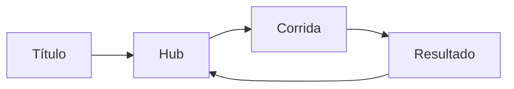

> 📝 **Como preencher:** substitua o que está entre `< >` e troque as linhas **Exemplo** pelo conteúdo real. O exemplo usa um jogo fictício: *Farol Perdido* (roguelite 2D de ação).

# 🕹️ Controles e UX

## Mapa de controles
| Ação | Teclado/Mouse | Controle | Toque |
|---|---|---|---|
| <Ação> | | | |
| **Exemplo:** Mover | WASD | Analógico esq. | Joystick virtual |
| **Exemplo:** Pulso de luz | Espaço | B | Botão |

## HUD (o que sempre aparece)
- <Elemento> — **Exemplo:** barra de luz (canto sup. esq.), moedas, mini-mapa.

## Fluxo de menus

## Acessibilidade (mínimo)
- [ ] Remapeamento de teclas
- [ ] Opção para daltônicos
- [ ] Legendas e tamanho de texto ajustável
- [ ] <Outro>

## Princípios de feedback
<Todo ação tem resposta visual + sonora em ≤ 100 ms.>
