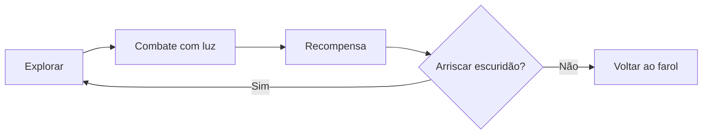

> 📝 **Como preencher:** substitua o que está entre `< >` e troque as linhas **Exemplo** pelo conteúdo real. O exemplo usa um jogo fictício: *Farol Perdido* (roguelite 2D de ação).

# 🔁 Core Loop

## Loop de 30 segundos (momento a momento)
<Ação → resultado → feedback → nova decisão>
**Exemplo:** Explorar sala → enfrentar inimigos usando a luz → coletar fragmentos → decidir entre ir ao escuro ou voltar à luz.

## Loop de sessão (uma corrida)
<Do início ao fim de uma partida>
**Exemplo:** Escolher ilha → 5–7 salas → chefe → upgrade → próxima ilha → morrer ou vencer.

## Loop de longo prazo (meta-progressão)
<O que faz o jogador voltar amanhã?>
**Exemplo:** Fragmentos desbloqueiam melhorias permanentes no farol.

## Fontes de diversão (por que é divertido)
- <Fonte> — **Exemplo:** risco/recompensa, build criativa.

## Pontos de falha conhecidos
- <Risco> — **Exemplo:** corridas repetitivas se as salas forem poucas.
