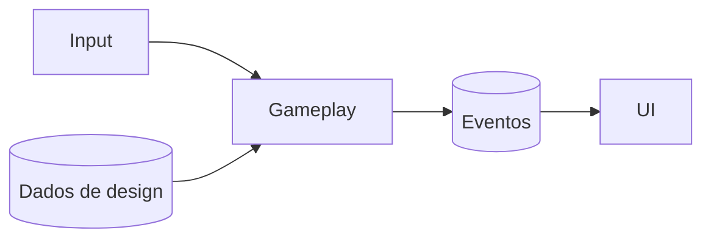

> 📝 **Como preencher:** substitua o que está entre `< >` e troque as linhas **Exemplo** pelo conteúdo real. O exemplo usa um jogo fictício: *Farol Perdido* (roguelite 2D de ação).


# 🏗️ Arquitetura de Código

## Estrutura do projeto da engine (`ARTEFATO/jogo/`)
```
jogo/
├── project.godot (ou ProjectSettings/)   # arquivo-raiz exigido pela engine
├── assets/        # arte, áudio, fontes (importados)
├── scenes/        # cenas/prefabs
├── scripts/       # código
│   ├── core/      # sistemas centrais (estado, eventos, save)
│   ├── gameplay/  # mecânicas
│   ├── ui/
│   └── data/      # carregadores dos dados de design
├── data/          # exportações de 04-dados-de-design/
└── tests/
```
> Adapte à engine escolhida. A raiz do projeto da engine **precisa** ficar em `ARTEFATO/jogo/`.

## Padrões
- <ex.: composição sobre herança; sinais/eventos para desacoplar>
- **Exemplo:** Sistemas se comunicam por eventos; nada de referências diretas entre gameplay e UI.

## Sistemas centrais
| Sistema | Responsabilidade | Observação |
|---|---|---|
| Estado do jogo | <fases, pausa> | |
| Save/Load | <formato, versão do save> | |
| Input | <mapeamento> | |
| Áudio | <bus, pooling> | |

## Diagrama


## Regra de ouro
**Nenhum valor de balanceamento no código.** Tudo vem de `data/`.
