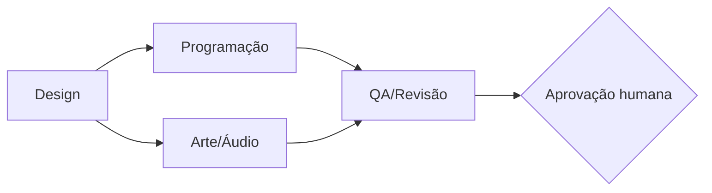

> 📝 **Como preencher:** substitua o que está entre `< >` e troque as linhas **Exemplo** pelo conteúdo real. O exemplo usa um jogo fictício: *Farol Perdido* (roguelite 2D de ação).

# 🤝 Papéis e Fluxo entre Agentes

| Agente | Missão | Entrada | Saída |
|---|---|---|---|
| Game Designer | Detalhar mecânicas e sistemas | ideia + pilares | `ARTEFATO/design/` |
| Programador | Implementar features | spec + dados | `ARTEFATO/jogo/` |
| Artista (briefing) | Criar briefs e direção | art-bible | `ARTEFATO/arte/` |
| Narrativa | Diálogos e lore | personagens | `ARTEFATO/design/` |
| QA/Revisor | Revisar e planejar playtests | entrega | parecer + `playtests/` |

## Regras de handoff
- Todo handoff leva: o que foi feito, o que falta, dúvidas abertas.
- Ninguém aprova o próprio trabalho.
