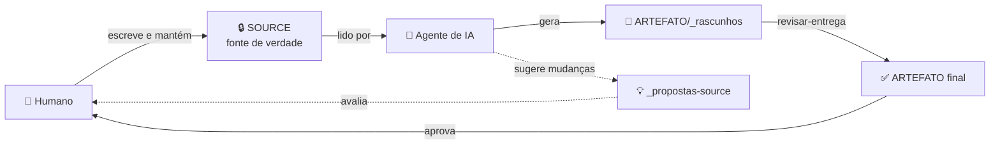
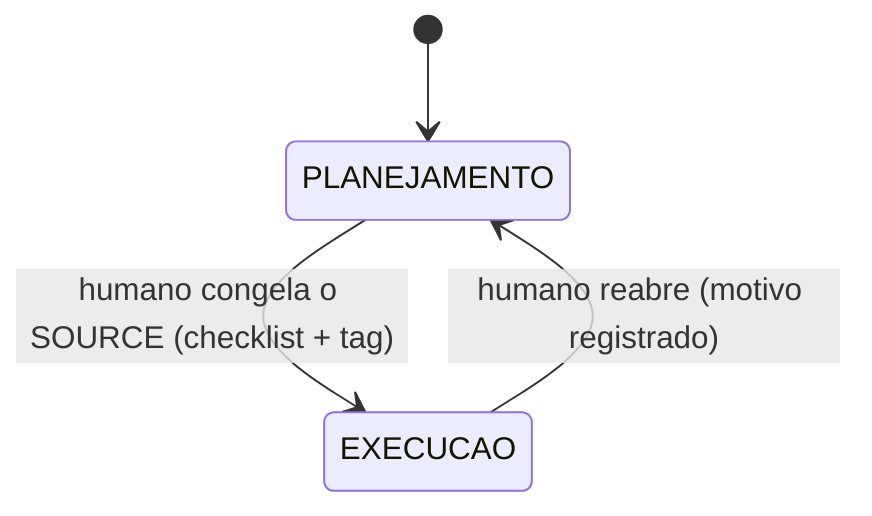
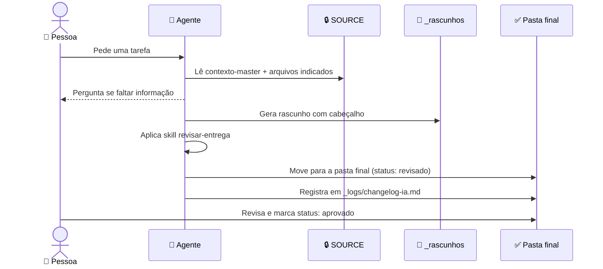

# 🧭 Guia da Arquitetura SOURCE / ARTEFATO

> Manual da equipe para usar, manter e evoluir este repositório de projetos com IA.
> Vale para **Claude, GPT, Cursor, Copilot** e outros, em projetos de **código** ou de **cowork/documentos**.

---

## 📑 Sumário
1. [Objetivo](#1--objetivo)
2. [A ideia em 1 minuto](#2--a-ideia-em-1-minuto)
3. [Modos de operação: PLANEJAMENTO e EXECUÇÃO](#3--modos-de-operação-planejamento-e-execução)
4. [Níveis de complexidade e Startup building](#4--níveis-de-complexidade-e-startup-building)
5. [Mapa completo](#5--mapa-completo)
6. [Princípios de ouro](#6--princípios-de-ouro)
7. [O ciclo de trabalho (modo EXECUÇÃO)](#7--o-ciclo-de-trabalho-modo-execução)
8. [Pasta por pasta](#8--pasta-por-pasta)
9. [Arquivo por arquivo](#9--arquivo-por-arquivo)
10. [Prompts de planejamento (um por arquivo)](#10--prompts-de-planejamento-um-por-arquivo)
11. [Papéis do time](#11--papéis-do-time)
12. [Módulos: o que manter e o que apagar](#12--módulos-o-que-manter-e-o-que-apagar)
13. [Como começar um projeto novo](#13--como-começar-um-projeto-novo)
14. [Convenções](#14--convenções)
15. [Erros comuns](#15--erros-comuns)
16. [FAQ](#16--faq)

---

## 1. 🎯 Objetivo

Dar a **qualquer pessoa e a qualquer agente de IA** a mesma resposta para três perguntas:

| Pergunta | Onde está a resposta |
|---|---|
| **O que é verdade e o que devo respeitar?** | `SOURCE/` |
| **O que já foi produzido?** | `ARTEFATO/` |
| **Quem pode mudar o quê?** | Princípios + Guardrails |

Benefícios: menos retrabalho, respostas consistentes entre ferramentas, auditoria do que a IA fez e onboarding rápido de novas pessoas.

---

## 2. ⚡ A ideia em 1 minuto



- 🔒 **SOURCE** = o que a IA **lê**. Em **PLANEJAMENTO** a IA também o edita (por prompt direto); em **EXECUÇÃO** só humanos editam.
- ✍️ **ARTEFATO** = o que a IA **escreve** (em EXECUÇÃO). Só humanos aprovam.
- 💡 **Propostas** = o canal para a IA pedir mudança no SOURCE **em EXECUÇÃO**.
- 🚦 **MODO.md** = a chave que define qual das duas regras vale agora.

---

## 3. 🔁 Modos de operação: PLANEJAMENTO e EXECUÇÃO

Todo projeto está **sempre em um de dois modos**, definido no arquivo `MODO.md` (raiz). **Só humanos** mudam o modo.



| | 📝 PLANEJAMENTO | ⚙️ EXECUÇÃO |
|---|---|---|
| **Objetivo** | Construir e editar o SOURCE | Produzir as entregas a partir do SOURCE |
| **IA edita SOURCE?** | ✅ Sim, por prompt direto, um arquivo por vez | ⛔ Não |
| **IA gera ARTEFATO final?** | ⛔ Não (só `_rascunhos/` e relatórios) | ✅ Sim |
| **Como a IA sugere mudanças** | Edita direto (com log) | Cria proposta em `ARTEFATO/_propostas-source/` |
| **Log** | `ARTEFATO/_logs/changelog-source.md` | `ARTEFATO/_logs/changelog-ia.md` |
| **Quem aprova** | Dono do projeto aprova o SOURCE | Humanos aprovam artefatos |

### Como funciona na prática
1. **Início:** `MODO.md` nasce em `PLANEJAMENTO`. Use a tabela de prompts (próxima seção) para a IA gerar a primeira versão de cada arquivo.
2. **Congelamento:** rode os prompts **PC** (consistência) e **PG** (gate), cumpra o checklist do `MODO.md`, faça commit + tag `source-v1.0` e mude `modo:` para `EXECUCAO`.
3. **Execução:** a IA lê o SOURCE e produz artefatos. Se achar erro, **propõe**; não edita.
4. **Reabertura:** quando houver propostas aceitas ou mudança de rumo, o humano volta para `PLANEJAMENTO`, edita, incrementa a versão e congela de novo.

### Segurança dos modos
- `AGENTS.md` manda a IA ler o `MODO.md` **antes de qualquer ação**.
- Modo ausente ou inválido = tratado como **EXECUÇÃO** (o mais restritivo).
- Nenhum modo permite que a IA edite `MODO.md`, `AGENTS.md` ou `CLAUDE.md`.
- Reforço opcional: `.claude/exemplos/` (permissões do Claude Code) e proteção da pasta `SOURCE/` na branch principal. Os dois são complementos; a regra é o `MODO.md`.
- As skills em `SOURCE/03-agentes/skills/` são usadas em **EXECUÇÃO**; em PLANEJAMENTO a IA trabalha com os prompts da tabela.

---

## 4. 🎚️ Níveis de complexidade e Startup building

O projeto nasce do template `ai-project-template` em **modo STARTUP**. O agente faz até 2 rodadas de perguntas, calcula a pontuação (5 perguntas, 0 a 10 pontos), mostra um **diagnóstico** para aprovação humana e só então cria a estrutura do nível a partir do pacote `niveis/<nivel>.zip`, pré-preenche o SOURCE, renomeia a pasta e entra em **PLANEJAMENTO**.

| | 🟢 SIMPLES | 🟡 MÉDIO | 🔴 COMPLEXO |
|---|---|---|---|
| Arquivos obrigatórios | 6 | 13 | 15 (+ opcionais) |
| Prompts de planejamento | 1 único | 1 por pasta | 1 por arquivo |
| Congelamento do SOURCE | opcional | por tag | gate completo (PC + PG) |
| Limite do contexto-master | 40 linhas | 80 linhas | 120 linhas |

- Pontuação, matriz de arquivos e promoção: **`NIVEIS.md`**.
- Prompts do seu nível (só com os arquivos que existem): **`PROMPTS-PLANEJAMENTO.md`**.
- Ferramenta do projeto (humanos rodam): `python tools/nivel.py verificar | promover | proteger`.
- O workflow `.github/workflows/verificar-nivel.yml` roda as verificações a cada push e PR. Nomes: `NOMENCLATURA.md`.

---

## 5. 🗺️ Mapa completo

```
📦 raiz-do-projeto/
├── 📄 README.md                  → porta de entrada para humanos
├── 📄 AGENTS.md                  → ponteiro universal para agentes de IA
├── 📄 CLAUDE.md                  → ponteiro para o Claude Code
├── 📄 GUIA-DA-ARQUITETURA.md     → manual completo + tabela de prompts
├── 🚦 MODO.md                    → PLANEJAMENTO ou EXECUÇÃO (só humanos alteram)
├── 📄 PROMPTS-PLANEJAMENTO.md    → prompts diretos para gerar cada arquivo do SOURCE
├── 📄 NIVEIS.md                  → nível do projeto (simples/médio/complexo), checklist e arquivos por nível
├── 📄 NOMENCLATURA.md            → nomes de repositórios, branches, commits e tags
├── 📄 niveis.json · 📁 tools/    → arquivos por nível e ferramenta nivel.py (humanos)
├── 📁 .github/workflows/         → verificação automática do template
├── 📁 .claude/                   → (opcional) adaptador nativo do Claude
│
├── 📁 SOURCE/                    → 🔒 FONTE DE VERDADE (humano edita, agente lê)
│   ├── 📄 contexto-master.md
│   ├── 📁 00-produto/            visao-e-escopo.md · requisitos.md
│   ├── 📁 01-dominio/            glossario.md · regras-de-negocio.md · fontes-de-verdade.md
│   ├── 📁 02-tecnico/            stack.md · arquitetura.md · convencoes.md
│   ├── 📁 03-agentes/            guardrails.md · papeis-e-fluxo.md · skills/
│   ├── 📁 04-qualidade/          definicao-de-pronto.md · checklist-revisao.md
│   ├── 📁 05-referencias/        exemplos-de-saida/ · schemas/ · templates/
│   └── 📁 06-decisoes/           ADR-000-modelo.md · ADR-001-exemplo.md
│
└── 📁 ARTEFATO/                  → ✍️ SAÍDA (agente escreve, humano aprova)
    ├── 📁 documentos/   📁 codigo/   📁 automacoes/
    ├── 📁 _rascunhos/   📁 _propostas-source/   📁 _logs/
```

---

## 6. 🏅 Princípios de ouro

| # | Princípio | Por quê |
|---|---|---|
| 1 | **SOURCE só é editável pela IA em PLANEJAMENTO** | Em EXECUÇÃO ela não reescreve as regras do jogo |
| 2 | **Contexto-master curto + "leia quando..."** | A IA carrega só o necessário; contexto não incha |
| 3 | **Tudo que a IA gera tem cabeçalho e status** | Rastreabilidade e auditoria |
| 4 | **Só humanos aprovam** | Responsabilidade final é de pessoas |
| 5 | **Dúvida = perguntar ou marcar `a confirmar`** | Nunca inventar dado |
| 6 | **Quem produz não aprova o próprio trabalho** | Revisão independente |
| 7 | **Núcleo mínimo + módulos opcionais** | Template leve; sem pasta vazia confundindo a IA |

---

## 7. 🔄 O ciclo de trabalho (modo EXECUÇÃO)



**Status de um artefato**

| Status | Significado | Quem muda |
|---|---|---|
| 🟡 `rascunho` | Em construção | Agente |
| 🔵 `revisado` | Passou no checklist | Agente revisor |
| 🟢 `aprovado` | Validado por pessoa | **Humano** |

---

## 8. 📁 Pasta por pasta

### Raiz
**Objetivo:** ser a porta de entrada. Contém só arquivos curtos e ponteiros.

### 🔒 `SOURCE/`
**Objetivo:** concentrar tudo que a IA precisa saber. **Quem mexe:** humanos; a IA também, mas só em PLANEJAMENTO. **Quem lê:** humanos e agentes.

| Pasta | Objetivo | Pergunta que responde | Módulo |
|---|---|---|---|
| `00-produto/` | Definir o **porquê** e os **limites** do projeto | "O que estamos construindo e o que NÃO estamos?" | Núcleo |
| `01-dominio/` | Ensinar o **negócio** à IA | "Como funciona o assunto e qual fonte vale?" | Núcleo |
| `02-tecnico/` | Fixar **como** construir | "Quais tecnologias, padrões e integrações?" | Núcleo/Código |
| `03-agentes/` | Dizer **como a IA deve agir** | "O que pode, o que não pode e qual passo a passo?" | Núcleo/Multiagente |
| `04-qualidade/` | Definir **quando está bom** | "Quando posso chamar de pronto?" | Núcleo |
| `05-referencias/` | Dar **exemplos e modelos** | "Como é uma boa entrega?" | Opcional |
| `06-decisoes/` | Guardar o **histórico de decisões** | "Por que foi feito assim?" | Opcional (recomendado) |

### ✍️ `ARTEFATO/`
**Objetivo:** receber tudo que a IA produz. **Quem escreve:** agentes. **Quem aprova:** humanos.

| Pasta | Objetivo |
|---|---|
| `documentos/` | Entregas textuais finais (relatórios, planos, specs) |
| `codigo/` | Aplicações, scripts e testes |
| `automacoes/` | Fluxos, integrações e rotinas |
| `_rascunhos/` | Área de trabalho; nada aqui é aprovado |
| `_propostas-source/` | Canal para a IA sugerir mudanças no SOURCE |
| `_logs/` | Registro do que a IA fez (`changelog-source` em PLANEJAMENTO, `changelog-ia` em EXECUÇÃO) |

> O prefixo `_` indica pastas **de processo** (não são entregas finais).

---

## 9. 📄 Arquivo por arquivo

### 7.1 Raiz

| Arquivo | Objetivo | Quem preenche | Quando atualizar |
|---|---|---|---|
| `README.md` | Apresentar o projeto a humanos e dar o passo a passo inicial | Dono do projeto | Quando a estrutura ou os responsáveis mudarem |
| `AGENTS.md` | Ponteiro universal: manda o agente ler o contexto-master e respeitar as regras | Responsável técnico | Raramente (é curto de propósito) |
| `CLAUDE.md` | Importa o `AGENTS.md` para o Claude Code (`@AGENTS.md`) | Responsável técnico | Só para ajustes específicos do Claude |
| `.claude/` | Adaptadores nativos do Claude Code e exemplos de permissão por modo (opcional) | Responsável técnico | Ao criar skills nativas ou trocar de modo |
| `MODO.md` | **Chave de modo**: PLANEJAMENTO ou EXECUÇÃO, permissões, checklist de congelamento e histórico | Dono do projeto (**só humanos**) | A cada mudança de modo |
| `PROMPTS-PLANEJAMENTO.md` | Cópia avulsa da tabela de prompts do guia, para uso rápido | Responsável técnico | Quando um arquivo do SOURCE for criado ou removido |

### 7.2 `SOURCE/` — arquivo raiz

| Arquivo | Objetivo | Conteúdo-chave |
|---|---|---|
| `contexto-master.md` | **Primeiro arquivo que a IA lê.** Resume o projeto e indica onde buscar cada coisa | Objetivo (3–5 linhas), usuários, regras inegociáveis, mapa "leia quando...", onde gravar saídas |

### 7.3 `SOURCE/00-produto/`

| Arquivo | Objetivo | Conteúdo-chave |
|---|---|---|
| `visao-e-escopo.md` | Alinhar problema, objetivo e limites | Problema, objetivo, ✅ dentro / ⛔ fora do escopo, métricas |
| `requisitos.md` | Listar o que precisa ser entregue e como validar | RF/RNF com ID, prioridade e critério de aceite |

### 7.4 `SOURCE/01-dominio/`

| Arquivo | Objetivo | Conteúdo-chave |
|---|---|---|
| `glossario.md` | Padronizar o vocabulário e evitar alucinação | Termo, definição, sigla, "não confundir com" |
| `regras-de-negocio.md` | Registrar regras e cálculos | Regras `RN-xx` (quando/então/exceção/fonte) e fórmulas |
| `fontes-de-verdade.md` | Resolver conflitos entre fontes | Hierarquia de fontes, onde está cada dado oficial, o que fazer se a fonte estiver indisponível |

### 7.5 `SOURCE/02-tecnico/` *(módulo código)*

| Arquivo | Objetivo | Conteúdo-chave |
|---|---|---|
| `stack.md` | Fixar tecnologias | Linguagens/versões, libs permitidas e proibidas, variáveis de ambiente (só nomes) |
| `arquitetura.md` | Explicar a estrutura técnica | Diagrama Mermaid, componentes, integrações/MCPs e limites de acesso, modelo de dados |
| `convencoes.md` | Padronizar o jeito de fazer | Nomenclatura, estilo, erros, testes, git, idioma |

### 7.6 `SOURCE/03-agentes/`

| Arquivo | Objetivo | Conteúdo-chave |
|---|---|---|
| `guardrails.md` | **Limites de segurança** da IA | ⛔ Nunca fazer, ✋ exige aprovação, ✅ pode sozinho, dados sensíveis |
| `papeis-e-fluxo.md` *(multiagente)* | Organizar vários agentes | Papéis, entradas/saídas, fluxo, regras de handoff |
| `skills/escrever-codigo.md` *(código)* | Receita para programar | Gatilhos, passo a passo, entrega, anti-padrões |
| `skills/escrever-documento.md` *(cowork)* | Receita para redigir | Tom, estrutura padrão, regras de fonte |
| `skills/revisar-entrega.md` | Auditoria antes de entregar | Passo a passo, formato do parecer |

> **Skill** = instrução reutilizável de *como* executar um tipo de tarefa. Crie uma skill nova sempre que uma tarefa se repetir.

### 7.7 `SOURCE/04-qualidade/`

| Arquivo | Objetivo | Conteúdo-chave |
|---|---|---|
| `definicao-de-pronto.md` | Critérios para considerar algo concluído | Checklist de entrega e estados do artefato |
| `checklist-revisao.md` | Lista usada na revisão | Itens de conteúdo, forma e técnica |

### 7.8 `SOURCE/05-referencias/`

| Caminho | Objetivo | Conteúdo-chave |
|---|---|---|
| `exemplos-de-saida/` | Mostrar **padrão-ouro** (few-shot) | Entregas reais aprovadas (mascare dados sensíveis) |
| `schemas/` | Formatos de dados | Exemplos JSON/CSV e campos obrigatórios |
| `templates/template-documento.md` | Modelo de documento | Cabeçalho + estrutura padrão |
| `templates/template-prompt.md` | Modelo de prompt reutilizável | Papel, objetivo, contexto, regras, formato, critério |

### 7.9 `SOURCE/06-decisoes/`

| Arquivo | Objetivo | Conteúdo-chave |
|---|---|---|
| `ADR-000-modelo.md` | Modelo de registro de decisão | Contexto, decisão, alternativas, consequências |
| `ADR-001-exemplo.md` | Exemplo preenchido | Apague ou substitua pelo seu primeiro ADR |

### 7.10 `ARTEFATO/`

| Arquivo | Objetivo |
|---|---|
| `README.md` | Regras da zona de saída, cabeçalho obrigatório e ciclo de vida |
| `*/README.md` | Descrição de cada subpasta |
| `_propostas-source/modelo-proposta.md` | Formato para a IA sugerir mudanças no SOURCE |
| `_logs/changelog-ia.md` | Linha do tempo do que a IA fez em EXECUÇÃO |
| `_logs/changelog-source.md` | Registro das edições do SOURCE feitas pela IA em PLANEJAMENTO |

### 7.11 Cabeçalho obrigatório de todo artefato

```yaml
---
gerado_por: <agente/ferramenta>
fontes: [SOURCE/<caminho>.md]
data: AAAA-MM-DD
status: rascunho        # rascunho | revisado | aprovado
---
```

---

## 10. 🧩 Prompts de planejamento (um por arquivo)

> Use no modo **PLANEJAMENTO**. Cada linha traz o que você precisa informar e o prompt direto para a IA gerar a **primeira versão** do arquivo. Troque os `[[campos]]` pelos seus dados. Execute na ordem da tabela: ela segue as dependências entre arquivos.
>
> **Dica:** abra a sessão com o prompt **P0** e, no fim, rode **PC** e **PG** antes de congelar.


### Prompts de controle (sessão e transição)

| Momento | Prompt direto |
|---|---|
| **P0 — Abrir sessão de planejamento** | Leia MODO.md e AGENTS.md. Confirme em uma linha que o modo é PLANEJAMENTO. Liste os arquivos do SOURCE que ainda têm placeholders <...>. Não edite nada até eu indicar o arquivo. |
| **PC — Checar consistência** | Modo PLANEJAMENTO. Leia todo o SOURCE e escreva em ARTEFATO/_rascunhos/relatorio-consistencia.md: contradições entre arquivos, lacunas, termos fora do glossário e números duplicados. Não edite o SOURCE. |
| **PG — Gate de congelamento** | Aplique o checklist de congelamento de MODO.md (núcleo preenchido e módulos não usados apagados) e responda se o SOURCE está pronto para EXECUÇÃO, listando pendências. Não altere o MODO.md. |
| **PE — Abrir sessão de execução** | Leia MODO.md e AGENTS.md. Confirme que o modo é EXECUCAO. Não edite nada em SOURCE. Se encontrar erro ou lacuna, crie uma proposta em ARTEFATO/_propostas-source/. Tarefa: [[tarefa]]. |
| **PV — Voltar ao planejamento** | (Primeiro eu mudo MODO.md para PLANEJAMENTO.) Modo PLANEJAMENTO retomado. Motivo: [[motivo]]. Edite apenas [[arquivo(s)]] com base em [[propostas aceitas / decisão]] e registre no changelog-source. |

### Prompts por arquivo

| # | Arquivo | Informações cruciais a fornecer | Prompt direto (copie e preencha os [[campos]]) |
|---|---|---|---|
| 1 | `SOURCE/contexto-master.md` | nome do projeto; objetivo em 3-5 linhas; perfis de usuário e o que fazem com o resultado; 3 a 7 regras inegociáveis; módulos mantidos | Modo PLANEJAMENTO: edite SOURCE/contexto-master.md. Dados: [[nome do projeto]]; [[objetivo em 3-5 linhas]]; [[perfis de usuário e o que fazem com o resultado]]; [[3 a 7 regras inegociáveis]]; [[módulos mantidos]]. Preencha todas as seções, monte o mapa 'leia quando' só com arquivos que existem e mantenha até 2 páginas. Reexecute ao final do planejamento para atualizar o mapa. Siga o template do arquivo, troque os exemplos pelos meus dados, não invente (use 'a confirmar') e registre no ARTEFATO/_logs/changelog-source.md. |
| 2 | `SOURCE/00-produto/visao-e-escopo.md` | problema; objetivo mensurável; resultado esperado; itens dentro do escopo; itens fora do escopo; premissas e restrições; métricas (hoje e meta) | Modo PLANEJAMENTO: edite SOURCE/00-produto/visao-e-escopo.md. Dados: [[problema]]; [[objetivo mensurável]]; [[resultado esperado]]; [[itens dentro do escopo]]; [[itens fora do escopo]]; [[premissas e restrições]]; [[métricas (hoje e meta)]]. Escreva de forma objetiva; o 'fora do escopo' deve ser explícito. Siga o template do arquivo, troque os exemplos pelos meus dados, não invente (use 'a confirmar') e registre no ARTEFATO/_logs/changelog-source.md. |
| 3 | `SOURCE/00-produto/requisitos.md` | funcionalidades desejadas; prioridade de cada uma; critério de aceite de cada uma; requisitos não funcionais (segurança, LGPD, desempenho) | Modo PLANEJAMENTO: edite SOURCE/00-produto/requisitos.md. Dados: [[funcionalidades desejadas]]; [[prioridade de cada uma]]; [[critério de aceite de cada uma]]; [[requisitos não funcionais (segurança, LGPD, desempenho)]]. Numere RF-xx e RNF-xx; cada requisito precisa de critério de aceite testável. Siga o template do arquivo, troque os exemplos pelos meus dados, não invente (use 'a confirmar') e registre no ARTEFATO/_logs/changelog-source.md. |
| 4 | `SOURCE/01-dominio/glossario.md` | 10 a 30 termos do negócio; significado de cada termo; siglas e sinônimos; termos que se confundem | Modo PLANEJAMENTO: edite SOURCE/01-dominio/glossario.md. Dados: [[10 a 30 termos do negócio]]; [[significado de cada termo]]; [[siglas e sinônimos]]; [[termos que se confundem]]. Ordene alfabeticamente e inclua a coluna 'não confundir com'. Siga o template do arquivo, troque os exemplos pelos meus dados, não invente (use 'a confirmar') e registre no ARTEFATO/_logs/changelog-source.md. |
| 5 | `SOURCE/01-dominio/regras-de-negocio.md` | regras em linguagem natural; exceções de cada regra; cálculos com exemplo numérico; fonte/validador de cada regra | Modo PLANEJAMENTO: edite SOURCE/01-dominio/regras-de-negocio.md. Dados: [[regras em linguagem natural]]; [[exceções de cada regra]]; [[cálculos com exemplo numérico]]; [[fonte/validador de cada regra]]. Converta em RN-xx no formato quando/então/exceção/fonte e inclua um exemplo numérico por cálculo. Siga o template do arquivo, troque os exemplos pelos meus dados, não invente (use 'a confirmar') e registre no ARTEFATO/_logs/changelog-source.md. |
| 6 | `SOURCE/01-dominio/fontes-de-verdade.md` | fontes oficiais por assunto; link ou local de cada uma; responsável e frequência de revisão; ordem de prevalência em conflito; o que fazer se a fonte estiver indisponível | Modo PLANEJAMENTO: edite SOURCE/01-dominio/fontes-de-verdade.md. Dados: [[fontes oficiais por assunto]]; [[link ou local de cada uma]]; [[responsável e frequência de revisão]]; [[ordem de prevalência em conflito]]; [[o que fazer se a fonte estiver indisponível]]. Monte a hierarquia e a tabela de fontes. Siga o template do arquivo, troque os exemplos pelos meus dados, não invente (use 'a confirmar') e registre no ARTEFATO/_logs/changelog-source.md. |
| 7 | `SOURCE/02-tecnico/stack.md (código)` | linguagem e versão; framework; banco/armazenamento; modelo de IA a usar; bibliotecas permitidas e proibidas; nomes (sem valores) das variáveis de ambiente | Modo PLANEJAMENTO: edite SOURCE/02-tecnico/stack.md. Dados: [[linguagem e versão]]; [[framework]]; [[banco/armazenamento]]; [[modelo de IA a usar]]; [[bibliotecas permitidas e proibidas]]; [[nomes (sem valores) das variáveis de ambiente]]. Justifique cada escolha em uma linha. Siga o template do arquivo, troque os exemplos pelos meus dados, não invente (use 'a confirmar') e registre no ARTEFATO/_logs/changelog-source.md. |
| 8 | `SOURCE/02-tecnico/arquitetura.md (código)` | componentes e responsabilidades; integrações (sistema, tipo, autenticação); o que o agente pode e não pode fazer em cada integração; fluxo de dados; entidades principais | Modo PLANEJAMENTO: edite SOURCE/02-tecnico/arquitetura.md. Dados: [[componentes e responsabilidades]]; [[integrações (sistema, tipo, autenticação)]]; [[o que o agente pode e não pode fazer em cada integração]]; [[fluxo de dados]]; [[entidades principais]]. Inclua um diagrama Mermaid e a tabela de integrações com 'pode' e 'não pode'. Siga o template do arquivo, troque os exemplos pelos meus dados, não invente (use 'a confirmar') e registre no ARTEFATO/_logs/changelog-source.md. |
| 9 | `SOURCE/02-tecnico/convencoes.md` | padrão de nomes; linter/formatter; regra de tratamento de erros; política de testes; padrão de git; idioma de código e documentos | Modo PLANEJAMENTO: edite SOURCE/02-tecnico/convencoes.md. Dados: [[padrão de nomes]]; [[linter/formatter]]; [[regra de tratamento de erros]]; [[política de testes]]; [[padrão de git]]; [[idioma de código e documentos]]. Dê um exemplo concreto por convenção. Siga o template do arquivo, troque os exemplos pelos meus dados, não invente (use 'a confirmar') e registre no ARTEFATO/_logs/changelog-source.md. |
| 10 | `SOURCE/03-agentes/guardrails.md` | ações proibidas; ações que exigem aprovação e quem aprova; ações livres; dados sensíveis e como tratá-los | Modo PLANEJAMENTO: edite SOURCE/03-agentes/guardrails.md. Dados: [[ações proibidas]]; [[ações que exigem aprovação e quem aprova]]; [[ações livres]]; [[dados sensíveis e como tratá-los]]. Mantenha a regra de modos: SOURCE só é editável em PLANEJAMENTO. Siga o template do arquivo, troque os exemplos pelos meus dados, não invente (use 'a confirmar') e registre no ARTEFATO/_logs/changelog-source.md. |
| 11 | `SOURCE/03-agentes/papeis-e-fluxo.md (multiagente)` | agentes (nome, missão); entrada e saída de cada um; ordem de execução; regras de handoff; limites de autonomia | Modo PLANEJAMENTO: edite SOURCE/03-agentes/papeis-e-fluxo.md. Dados: [[agentes (nome, missão)]]; [[entrada e saída de cada um]]; [[ordem de execução]]; [[regras de handoff]]; [[limites de autonomia]]. Inclua um fluxograma Mermaid; nenhum agente aprova o próprio trabalho. Siga o template do arquivo, troque os exemplos pelos meus dados, não invente (use 'a confirmar') e registre no ARTEFATO/_logs/changelog-source.md. |
| 12 | `SOURCE/03-agentes/skills/escrever-codigo.md (código)` | gatilhos da tarefa; arquivos a ler antes; passo a passo preferido; entrega esperada; anti-padrões | Modo PLANEJAMENTO: edite SOURCE/03-agentes/skills/escrever-codigo.md. Dados: [[gatilhos da tarefa]]; [[arquivos a ler antes]]; [[passo a passo preferido]]; [[entrega esperada]]; [[anti-padrões]]. Escreva como receita numerada e curta. Siga o template do arquivo, troque os exemplos pelos meus dados, não invente (use 'a confirmar') e registre no ARTEFATO/_logs/changelog-source.md. |
| 13 | `SOURCE/03-agentes/skills/escrever-documento.md (cowork)` | tipos de documento; tom e estilo; estrutura padrão; regras de citação de fontes | Modo PLANEJAMENTO: edite SOURCE/03-agentes/skills/escrever-documento.md. Dados: [[tipos de documento]]; [[tom e estilo]]; [[estrutura padrão]]; [[regras de citação de fontes]]. Escreva como receita numerada e curta. Siga o template do arquivo, troque os exemplos pelos meus dados, não invente (use 'a confirmar') e registre no ARTEFATO/_logs/changelog-source.md. |
| 14 | `SOURCE/03-agentes/skills/revisar-entrega.md` | o que será auditado; fontes de verdade a conferir; formato do parecer | Modo PLANEJAMENTO: edite SOURCE/03-agentes/skills/revisar-entrega.md. Dados: [[o que será auditado]]; [[fontes de verdade a conferir]]; [[formato do parecer]]. Mantenha a regra: quem revisa não é quem produziu e nunca marca 'aprovado'. Siga o template do arquivo, troque os exemplos pelos meus dados, não invente (use 'a confirmar') e registre no ARTEFATO/_logs/changelog-source.md. |
| 15 | `SOURCE/04-qualidade/definicao-de-pronto.md` | critérios obrigatórios de entrega; critérios específicos do projeto; quem aprova cada tipo de entrega | Modo PLANEJAMENTO: edite SOURCE/04-qualidade/definicao-de-pronto.md. Dados: [[critérios obrigatórios de entrega]]; [[critérios específicos do projeto]]; [[quem aprova cada tipo de entrega]]. Liste como checklist e mantenha a tabela de status. Siga o template do arquivo, troque os exemplos pelos meus dados, não invente (use 'a confirmar') e registre no ARTEFATO/_logs/changelog-source.md. |
| 16 | `SOURCE/04-qualidade/checklist-revisao.md` | itens de conteúdo; itens de forma; itens técnicos; itens próprios do projeto | Modo PLANEJAMENTO: edite SOURCE/04-qualidade/checklist-revisao.md. Dados: [[itens de conteúdo]]; [[itens de forma]]; [[itens técnicos]]; [[itens próprios do projeto]]. Cada item deve ser verificável com sim/não. Siga o template do arquivo, troque os exemplos pelos meus dados, não invente (use 'a confirmar') e registre no ARTEFATO/_logs/changelog-source.md. |
| 17 | `SOURCE/05-referencias/exemplos-de-saida/exemplo-documento.md (cowork)` | entrega real aprovada para usar de padrão-ouro; dados sensíveis a mascarar | Modo PLANEJAMENTO: edite SOURCE/05-referencias/exemplos-de-saida/exemplo-documento.md. Dados: [[entrega real aprovada para usar de padrão-ouro]]; [[dados sensíveis a mascarar]]. Apenas formate e anonimize; não altere o conteúdo. Siga o template do arquivo, troque os exemplos pelos meus dados, não invente (use 'a confirmar') e registre no ARTEFATO/_logs/changelog-source.md. |
| 18 | `SOURCE/05-referencias/schemas/exemplo-payload.md (código)` | campos de entrada/saída; tipos e obrigatoriedade; 1 a 2 exemplos fictícios | Modo PLANEJAMENTO: edite SOURCE/05-referencias/schemas/exemplo-payload.md. Dados: [[campos de entrada/saída]]; [[tipos e obrigatoriedade]]; [[1 a 2 exemplos fictícios]]. Gere JSON/CSV válidos com dados fictícios. Siga o template do arquivo, troque os exemplos pelos meus dados, não invente (use 'a confirmar') e registre no ARTEFATO/_logs/changelog-source.md. |
| 19 | `SOURCE/05-referencias/templates/template-documento.md` | seções padrão; tom; tipos de documento atendidos | Modo PLANEJAMENTO: edite SOURCE/05-referencias/templates/template-documento.md. Dados: [[seções padrão]]; [[tom]]; [[tipos de documento atendidos]]. Mantenha o bloco de cabeçalho de rastreabilidade. Siga o template do arquivo, troque os exemplos pelos meus dados, não invente (use 'a confirmar') e registre no ARTEFATO/_logs/changelog-source.md. |
| 20 | `SOURCE/05-referencias/templates/template-prompt.md` | tarefas recorrentes; regras fixas de todo prompt; formato de saída padrão | Modo PLANEJAMENTO: edite SOURCE/05-referencias/templates/template-prompt.md. Dados: [[tarefas recorrentes]]; [[regras fixas de todo prompt]]; [[formato de saída padrão]]. Inclua um exemplo preenchido real do projeto. Siga o template do arquivo, troque os exemplos pelos meus dados, não invente (use 'a confirmar') e registre no ARTEFATO/_logs/changelog-source.md. |
| 21 | `SOURCE/06-decisoes/ADR-00X-titulo.md` | situação que exigiu decidir; decisão tomada; alternativas com prós e contras; consequências e riscos; decisores e data | Modo PLANEJAMENTO: edite SOURCE/06-decisoes/ADR-00X-titulo.md. Dados: [[situação que exigiu decidir]]; [[decisão tomada]]; [[alternativas com prós e contras]]; [[consequências e riscos]]; [[decisores e data]]. Crie o arquivo a partir do ADR-000-modelo.md com o próximo número. Siga o template do arquivo, troque os exemplos pelos meus dados, não invente (use 'a confirmar') e registre no ARTEFATO/_logs/changelog-source.md. |

**Como usar bem**
1. Um arquivo por vez; revise o resultado antes de ir para o próximo.
2. Se um dado crucial faltar, deixe o campo como `a confirmar`; a IA não deve inventar.
3. Ao final, reexecute o prompt do `contexto-master.md` para atualizar o mapa.

---

## 11. 👥 Papéis do time

| Papel | Responsabilidades | Mexe no SOURCE? | Aprova artefatos? |
|---|---|---|---|
| **Dono do projeto** | Objetivo, escopo, prioridades; aprova mudanças de `00-produto` | ✅ | ✅ |
| **Especialista do domínio** | Mantém `01-dominio` e `fontes-de-verdade` | ✅ (seu domínio) | ✅ (conteúdo) |
| **Responsável técnico** | Mantém `02-tecnico`, `03-agentes`, ponteiros da raiz | ✅ | ✅ (técnico) |
| **Usuário do dia a dia** | Pede tarefas à IA, revisa e aprova entregas | ❌ (sugere) | ✅ |
| **Agente de IA** | Planejamento: edita o SOURCE por prompt. Execução: lê o SOURCE, gera artefatos e propõe mudanças | ⚠️ só em PLANEJAMENTO | ❌ |

---

## 12. 🧩 Módulos: o que manter e o que apagar

### Núcleo (todo projeto)
`contexto-master` · `visao-e-escopo` · `glossario` · `convencoes` · `guardrails` · `definicao-de-pronto` · `revisar-entrega`

### Opcionais

| Se o projeto... | Mantenha |
|---|---|
| Gera **código** | `stack`, `arquitetura`, `escrever-codigo`, `schemas`, `requisitos` |
| Gera **documentos / cowork** | `escrever-documento`, `templates`, `exemplos-de-saida`, `fontes-de-verdade` |
| Usa **vários agentes** | `papeis-e-fluxo` |
| Tem decisões importantes | `06-decisoes` |

> 🧹 **Apague o que não for usar** e remova a linha correspondente do mapa em `contexto-master.md`. Pasta vazia ou arquivo com `<placeholder>` confunde a IA.

---

## 13. 🏁 Como começar um projeto novo

- [ ] No GitHub, **Use this template** → baixe ou clone e abra a pasta **localmente**
- [ ] Abra o agente na pasta e digite `/startup` (Claude Code) ou `startup` (Cowork e outros)
- [ ] Responda as perguntas (até 2 rodadas) e **aprove o diagnóstico**
- [ ] O agente cria a estrutura do nível, pré-preenche o SOURCE, renomeia a pasta e entra em **PLANEJAMENTO**
- [ ] Reabra a sessão na pasta nova e rode o prompt **P0** de `PROMPTS-PLANEJAMENTO.md`
- [ ] Complete o SOURCE com os prompts do seu nível e resolva `ARTEFATO/_logs/pendencias-startup.md`
- [ ] Rode `python tools/nivel.py verificar` (e **PC** + **PG** no nível COMPLEXO)
- [ ] Crie o repositório no GitHub com o mesmo nome da pasta e suba o projeto
- [ ] Congele o SOURCE (commit + tag `source-v1.0`) e mude `MODO.md` para `EXECUCAO`

---

## 14. 📏 Convenções

| Item | Regra | Exemplo |
|---|---|---|
| Nomes de pastas/arquivos | minúsculo, sem acento, com hífen | `regras-de-negocio.md` |
| Pastas numeradas no SOURCE | `NN-nome` define a ordem de leitura | `01-dominio` |
| Pastas de processo no ARTEFATO | prefixo `_` | `_rascunhos` |
| Artefatos | `AAAA-MM-DD_tipo_nome.ext` | `2026-11-21_relatorio_divergencias.md` |
| Regras de negócio | IDs `RN-xx` | `RN-02` |
| Requisitos | `RF-xx` / `RNF-xx` | `RF-01` |
| Decisões | `ADR-00X-titulo.md` | `ADR-002-escolha-do-banco.md` |
| Placeholders | `<texto>` | `<nome do projeto>` |

---

## 15. ⚠️ Erros comuns

| ❌ Erro | ✅ Correção |
|---|---|
| Contexto-master virou um livro | Deixe em 1–2 páginas; detalhe vai nos outros arquivos |
| Deixar `<placeholders>` nos arquivos | Preencha ou apague o arquivo |
| Pedir à IA para "atualizar o SOURCE" em EXECUÇÃO | Peça uma **proposta** em `_propostas-source/` ou volte ao PLANEJAMENTO |
| Aprovar sem revisar | Use o checklist; só pessoas aprovam |
| Colar dados reais sensíveis nos exemplos | Mascare ou use dados fictícios |
| Duplicar a mesma regra em vários arquivos | Uma regra, um lugar; os outros apontam para ele |
| Esquecer de atualizar o mapa | Todo arquivo novo entra no "leia quando..." |

---

## 16. ❓ FAQ

**Preciso usar todas as pastas?** Não. Use o núcleo e apague os módulos que não precisa.

**A IA não está lendo o SOURCE.** Confirme que `AGENTS.md`/`CLAUDE.md` estão na raiz e que o `contexto-master.md` tem o mapa. Se necessário, peça explicitamente: "leia `SOURCE/contexto-master.md` primeiro".

**Posso usar com ChatGPT sem acesso a arquivos?** Sim: cole o `contexto-master.md` e os arquivos relevantes no início da conversa (ou em instruções do projeto/GPT personalizado).

**Onde guardo senhas e chaves?** Em lugar nenhum deste repositório. Documente apenas o **nome** das variáveis em `stack.md`.

**Como a IA sugere uma mudança no SOURCE em EXECUÇÃO?** Criando um arquivo em `ARTEFATO/_propostas-source/` com o `modelo-proposta.md`.

**Qual a diferença entre `skills/` e `papeis-e-fluxo.md`?** Skill = *como fazer uma tarefa*. Papel = *quem faz qual parte* num fluxo com vários agentes.

**Quando criar uma skill nova?** Quando a mesma instrução for repetida mais de duas vezes.

**Posso versionar com Git?** Sim e é recomendado. Proteja a branch principal para que mudanças no `SOURCE/` passem por revisão.
