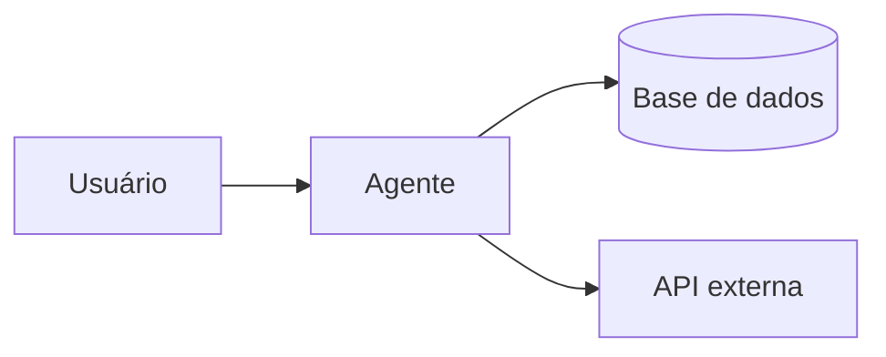

# 🏗️ Arquitetura

> 📝 **Como preencher:** substitua o que está entre `< >` e apague as linhas de exemplo quando tiver o conteúdo real.

## Visão geral
<Descreva em 1 parágrafo como as partes se conectam.>

## Diagrama

> Substitua pelo desenho real do seu projeto.

## Componentes
| Componente | Responsabilidade | Tecnologia |
|---|---|---|
| <Nome> | <O que faz> | <Tech> |

## Integrações e conectores (APIs, ERPs, MCPs)
| Sistema | Tipo | Autenticação | O agente pode... | O agente NÃO pode... |
|---|---|---|---|---|
| <Sistema> | API/MCP/Arquivo | <como> | ler | escrever |
| **Exemplo:** ERP | API | token (vault) | consultar fornecedores | lançar títulos |

## Modelo de dados (resumo)
<Entidades principais e relacionamentos.>

## Decisões relevantes
Veja `06-decisoes/` — ex.: `ADR-001`.
