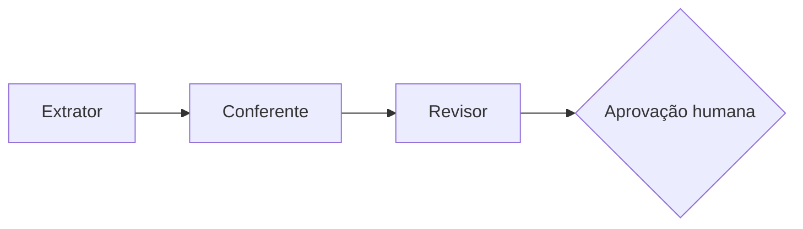

# 🤝 Papéis e Fluxo entre Agentes

> 📝 **Como preencher:** substitua o que está entre `< >` e apague as linhas de exemplo quando tiver o conteúdo real.

> Use só se houver multiagente. Em projeto simples, apague este arquivo.

## Papéis
| Agente | Missão | Entrada | Saída | Pode usar |
|---|---|---|---|---|
| <Nome> | <Missão> | <o que recebe> | <o que entrega> | <ferramentas> |
| **Exemplo:** Extrator | Ler PDFs e gerar JSON | PDF | `ARTEFATO/_rascunhos/*.json` | leitura de arquivos |
| **Exemplo:** Revisor | Aplicar `checklist-revisao.md` | rascunho | parecer + status | skill `revisar-entrega` |

## Fluxo

## Regras de passagem (handoff)
- Todo handoff leva: **o que foi feito, o que falta, dúvidas abertas**.
- Nenhum agente aprova o próprio trabalho.

## Limites de autonomia
- <Quantas tentativas, quando escalar para humano.>
