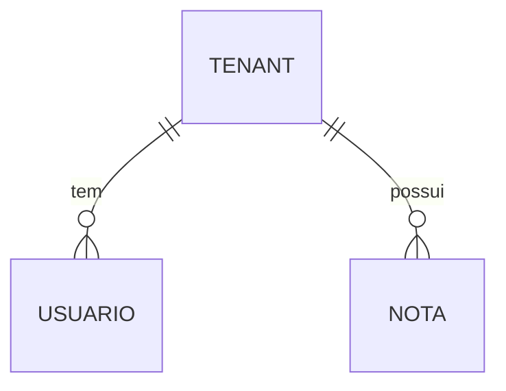

# 🗄️ Modelo de dados

> 📝 **Como preencher:** substitua o que está entre `< >` e apague as linhas de exemplo quando tiver o conteúdo real.

## Entidades
| Entidade | Descrição | Pertence ao tenant? | Dados pessoais? |
|---|---|---|---|
| <entidade> | <descrição> | ✅/⛔ | <quais> |
| **Exemplo:** `tenant` | Empresa cliente que assina | — | Razão social, CNPJ |
| **Exemplo:** `usuario` | Pessoa com login | ✅ | Nome, e-mail |
| **Exemplo:** `nota` | Nota fiscal enviada | ✅ | — |

## Campos padrão de toda tabela de negócio
`id` (UUID) · `tenant_id` · `criado_em` · `atualizado_em` · `excluido_em` (soft delete, se usar)

## Relacionamentos

## Regras de migração
1. Toda mudança de schema é uma migração versionada em `ARTEFATO/codigo/` (nunca alteração manual no banco).
2. Migrações são **compatíveis para trás** (adicionar antes de remover; remover só na release seguinte).
3. <Ferramenta de migração: ex.: Prisma, Alembic>
